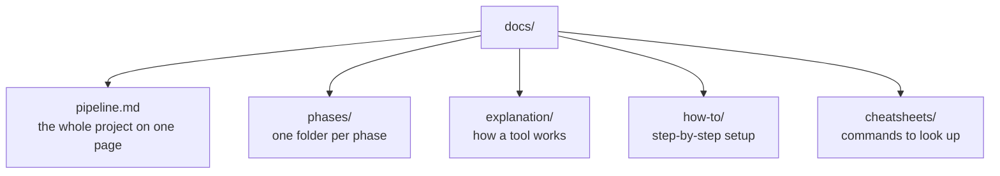

# Documentation

## How the docs are organized

**Explain** documents (`pipeline.md`, `phases/`, `explanation/`) answer *why*, with diagrams. **Technical** documents (`how-to/`, `cheatsheets/`) answer *how*, with commands.

## Every phase folder has the same shape

| File | Answers |
|---|---|
| `README.md` | Which problems does this phase solve? Which tool, and why? The analogy, the trade-offs, the list of steps |
| `1-...md`, `2-...md`, ... | One file per step: one small change, its problem, before and after, how to verify it |
| `result.md` | What is fixed, what remains open, what new limitations appeared |

## Index

### Explain

| Document | Covers |
|---|---|
| [pipeline.md](pipeline.md) | Every phase: problem, tool, cost, limitation |
| [phases/phase-1-local-server](phases/phase-1-local-server/README.md) | A local server |
| [phases/phase-2-public-url](phases/phase-2-public-url/README.md) | A public URL through a tunnel, and its risks |
| [phases/phase-3-container](phases/phase-3-container/README.md) | Packaging and running the app with Docker |
| [explanation/docker.md](explanation/docker.md) | How Docker works: images, containers, kernel, ports, signals, Compose |

### Technical

| Document | Covers |
|---|---|
| [how-to/setup.md](how-to/setup.md) | Setting up the development machine (WSL, Git, SSH, Docker, cloudflared) |
| [cheatsheets/docker.md](cheatsheets/docker.md) | Docker and Compose commands, this project's files line by line, common errors |
