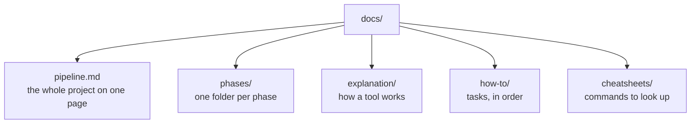

# Documentation

## How the docs are organized

**Phases** record what happened, and are never rewritten. Everything else is **living**: kept true for the current state. **Explanation** answers *why*; **how-to** gives ordered steps for a task; **cheat sheets** list commands to look up.

## Every phase folder has the same shape

| File | Answers |
|---|---|
| `README.md` | Which problems does this phase solve? Which tool, and why? The analogy, the trade-offs, the list of steps |
| `1-...md`, `2-...md`, ... | One file per step: one small change, its problem, before and after, how to verify it |
| `result.md` | What is fixed, what remains open, what new limitations appeared |

## Index

### The project

| Document | Covers |
|---|---|
| [pipeline.md](pipeline.md) | Every phase: problem, tool, cost, limitation; the plan ahead |
| [lessons-learned.md](lessons-learned.md) | Every backtrack, and the right choice in hindsight |

### Phases: what happened, step by step

| Phase | Covers |
|---|---|
| [1. Local server](phases/phase-1-local-server/README.md) | The smallest HTTP server |
| [2. Public URL](phases/phase-2-public-url/README.md) | A quick tunnel, and its risks |
| [3. Container](phases/phase-3-container/README.md) | Packaging and running the app with Docker and Compose |
| [4. Continuous integration](phases/phase-4-continuous-integration/README.md) | Building, testing, and publishing every change with GitHub Actions |
| [5. Production on the domain](phases/phase-5-production/README.md) | Graceful shutdown, a named tunnel, the tested image in production |
| [6. Kubernetes and Helm](phases/phase-6-kubernetes-and-helm/README.md) | A local cluster, zero-downtime deploys, a Helm release |

### Explanation: how tools work

| Document | Covers |
|---|---|
| [docker.md](explanation/docker.md) | Images, containers, kernel, ports, signals, Compose |
| [github-actions.md](explanation/github-actions.md) | Workflows, jobs, steps, artifacts, secrets |
| [kubernetes.md](explanation/kubernetes.md) | Cluster, pods, Deployments, Services, probes, rolling updates, Helm |
| [analogy.md](explanation/analogy.md) | One analogy for the whole project, a diagram per phase |

### How-to: tasks, in order

| Document | Covers |
|---|---|
| [set-up-the-development-machine.md](how-to/set-up-the-development-machine.md) | WSL, Git, SSH, Docker, k3d, kubectl, Helm |
| [configure-the-github-repository.md](how-to/configure-the-github-repository.md) | Ruleset, pull requests, security, Actions, package: steps and settings |
| [set-up-the-domain-and-tunnel.md](how-to/set-up-the-domain-and-tunnel.md) | Domain, Cloudflare, tunnel, token: steps and settings |
| [run-production.md](how-to/run-production.md) | Start, stop, what starts by itself, deploy, first-time setup, fallback |

### Cheat sheets: commands to look up

| Document | Covers |
|---|---|
| [docker.md](cheatsheets/docker.md) | Docker and Compose commands, common errors |
| [kubernetes.md](cheatsheets/kubernetes.md) | k3d, kubectl, and Helm commands, common errors |
