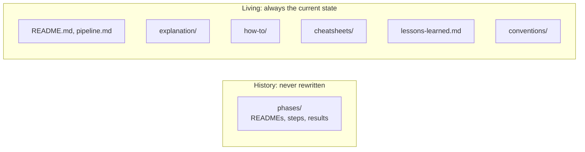

# Documentation

How the docs are written, and what kind of doc goes where.

## Two kinds of truth

- **Phase docs** say what was true at that time. Correcting a factual error is allowed; rewriting what happened isn't.
- **No forward pointers in phase docs:** a step lists its limitations; the later phase that fixes one points back to it.
- **A phase README** is current while its phase runs, and frozen when it ends.
- **Living docs** are updated in the same PR as the change that makes them outdated.

## Which kind of doc

| Kind | Answers | Example |
|---|---|---|
| Phase step | What problem, what changed, what it cost | `phases/phase-6-kubernetes-and-helm/11-deploy-a-new-version-without-downtime.md` |
| Explanation | Why a tool works the way it does | `explanation/kubernetes.md` |
| How-to | How to do a task, in order | `how-to/run-production.md` |
| Cheat sheet | Which command, at a glance | `cheatsheets/kubernetes.md` |

- **How-tos are named by task, starting with a verb.**
- **Settings made in a web interface** go into a how-to with **ordered steps** plus a **settings-at-a-glance** table.

## Style

- **Diagrams first** (Mermaid flowcharts and sequence diagrams), **tables second**, **short lists third**. No long paragraphs.
- **Mermaid without colors** or styling: readability on any theme.
- **Sequence diagrams show every hop,** request and response. No shortcuts like "back the same way."
- **A change to how users are served** gets a before-and-after diagram.
- **Plain words;** a term is defined the first time it's used; nothing depends on a concept introduced later.
- **One message per section.** Learning questions and their answers stay in the conversation, not in the docs.
- **Numbers, not adjectives:** "11 failed requests over ~6 s," not "some downtime."
- **Link to files** instead of copying them. Short code snapshots are fine in step docs, where they record a moment.
- **The analogy is defined once,** in [analogy.md](../explanation/analogy.md); other docs link to it with one line.
- **Titles name the problem or the result,** never just the tool: "Deploy a new version without downtime," not "Rolling update."

## Writing order

1. Implement and verify.
2. Write the docs from the **verified final state**: real outputs, real numbers.
3. Same PR as the change.

## Shapes

| Doc | Sections |
|---|---|
| Phase README | Status; The problems this phase solves; The tools; Expected trade-offs; Steps (table); Result (link) |
| Step | Problem; Change; How it works; How users are served (when it changes); Decisions; The analogy; Before and after; Limitations; Verify |
| Result | Progress (diagram + table); Measurements; The pipeline at the end of this phase; New limitations; Open limitations, ranked |

Templates: [phase README](templates/phase-readme.md), [step](templates/step.md), [result](templates/result.md).
