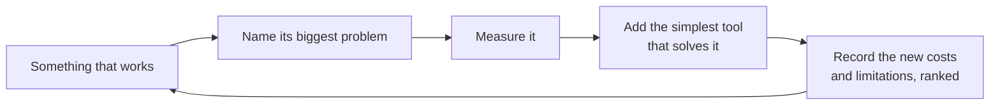

# Engineering Principles

How decisions are made.

## The loop

- **No tool "because it's best practice."** Each one solves a problem we can point at.
- **Measure before and after,** with the same method: the numbers decide, not expectations.
- **The simplest fix first:** one Compose line beats a cluster when it solves the problem (crashes: `restart: unless-stopped`); a new tool has to earn its place (deploy downtime needed Kubernetes).
- **Every fix creates limitations:** write them down, rank them; the top ones start the next phase.

## Practices

- **Infrastructure as Code first.** A setting made in a web interface is documented as ordered steps until it becomes code.
- **Test what you run:** development behaves like production (no `init` in Compose once Kubernetes, which has none, is the target).
- **Build once:** publish exactly the bytes that were tested, never a rebuild.
- **Protect the gate before the first release:** `main` is protected before anything is published from it.
- **Separate environments:** development is never public; production never builds.
- **Overlap instead of cutover:** switch traffic by running old and new side by side, then removing the old (Compose → cluster: 0 failed requests).
- **Declare simulations:** model realistic behavior openly when the app is too small to show a problem.
- **Know the environment's limits:** networks can block registries or tunnels; images are pulled in advance.
- **Scope is a decision:** changes in scope are recorded with their reason.
