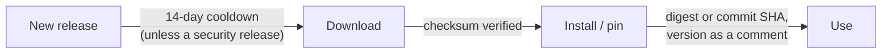

# Security

Defaults applied from the start, not added later.

## Supply chain

- **Images:** pinned by **tag and digest** (`name:tag@sha256:…`); the digest is what runs, the tag is for people.
- **GitHub Actions:** pinned by **full commit SHA**, with the version as a comment; enforced by a repository setting.
- **Tools** (k3d, kubectl, Helm, cloudflared): an exact release from the official source, **checksum verified** before running. Never `curl | bash`.
- **Cooldown:** a release at least 14 days old, unless it's a security release; exceptions are documented.
- **Allowed actions:** an explicit list in the repository settings; adding one is a deliberate change.

## Least privilege

- **Tokens:** read-only by default (`permissions: contents: read`); write access only in the one job that needs it.
- **Containers:** never as root (`USER node`).
- **Outside contributions:** workflows from forks run only after approval.
- **Third-party authorizations:** the smallest scope offered ("public data only"); refuse broader ones.
- **Accounts:** two-factor authentication everywhere (GitHub, Cloudflare, registrar).

## Secrets

| Rule | Why |
|---|---|
| `.gitignore` entry **before** the file exists | It can never be committed by accident |
| Files `chmod 600` | Only the owner can read them |
| Created with an editor, not `echo` | Commands land in the shell history |
| Passed through environment variables and stdin | Never part of script text or a command line |
| `${{ }}` only in `env:`, never inside `run:` | Prevents script injection in GitHub Actions |
| Never print resolved configuration (`docker compose config`, `kubectl get secret -o yaml`) | Both reveal the values |
| Given only to the component that needs it | `env_file` per service, Secret per Deployment |
| Rotated after a leak | The old value stops working |

- **Second line of defense:** GitHub push protection blocks pushes containing recognizable secrets.

## Exposure

- **Outbound tunnels over open ports:** nothing on the machine accepts connections from the internet.
- **Public by decision:** the image is public because it contains no secrets; every published artifact is checked for that.
