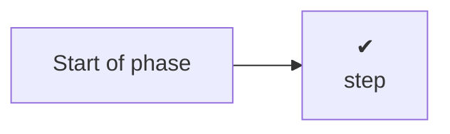

# Template: Phase Result

````markdown
# Phase <N>: Result

[← Phase <N>](README.md)

## Progress



| Problem | Status | Fixed by |
|---|---|---|
| | ✔ Fixed | Step <n>: <change> |

## Measurements

| | Before | After |
|---|---|---|
| | | |

## The pipeline at the end of this phase

```mermaid
<diagram>
```

## New limitations introduced by this phase

| Limitation | Why it matters |
|---|---|
| | |

## Open limitations, ranked

1. **<Most important>:** <one line>
````
