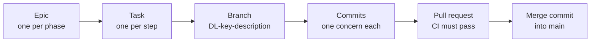
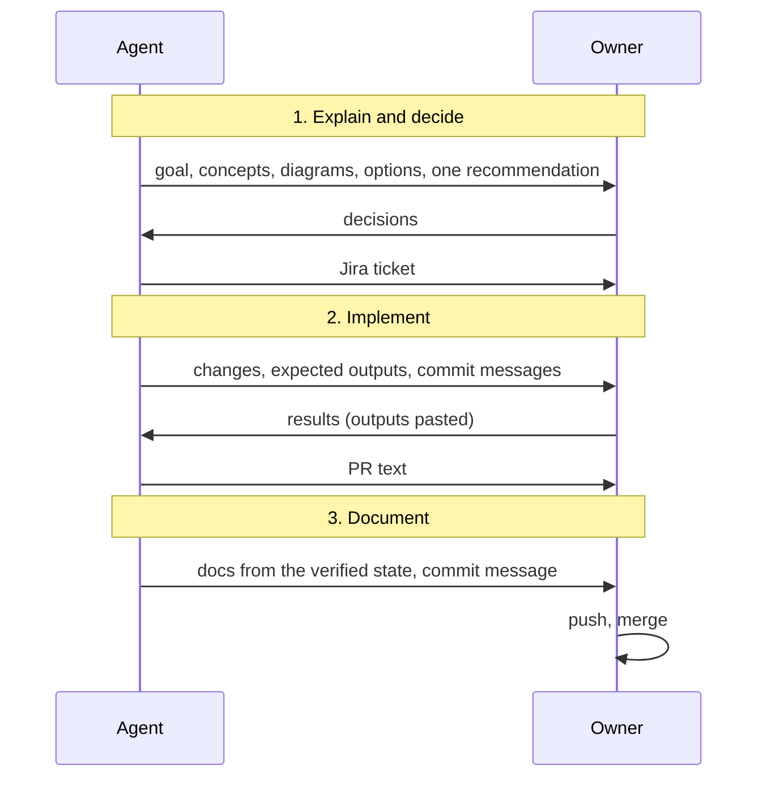

# Workflow

How work moves from an idea to `main`.

## The shape of the work

## Every step in three parts

- **Never mix parts** in one message; the owner corrects mistakes early, not 200 lines later.
- **The smallest step that can be understood on its own.** When a concept is new, split further.
- **One ticket = one problem.** Small fixes to docs can share one ticket.

## Jira

**Epic (one per phase):**

- **Goal:** what's true when the phase is done.
- **Problems:** the top-ranked open limitations from the previous phase's `result.md`.
- **Steps:** an outline; it will change.
- **Exit criteria.**
- **Outcome:** added when the epic is closed.

**Task:**

- **Goal** and **Acceptance criteria** only, as short `-` lists; code in backticks.
- **What, never how.** The how lives in the PR and the docs.

**Other epics:** "Documentation" for docs work across phases; "Future work" for ideas, one short ticket each.

Templates: [epic](templates/epic.md), [task](templates/task.md).

## Git

| Item | Convention |
|---|---|
| Branch | `DL-<key>-<kebab-description>`, matching the ticket's title |
| Commit | `DL-<key>: <Imperative sentence>`; separate commits for separate concerns |
| Merge | Merge commits only (squash and rebase disabled) |
| Pull | `pull.ff only`: a diverged branch is never merged by accident |
| Fetch | `fetch.prune true`: deleted remote branches disappear locally |
| `main` | Protected: pull request and passing CI required, no force push, no bypass |
| Rewriting | Only on an unmerged branch of your own, with `git push --force-with-lease` |

**Phase closing PRs** (`result.md`, phase README status, `pipeline.md`) use the **epic's** key.

## Pull requests

- **Title:** same form as the commit: `DL-<key>: <Imperative sentence>`.
- **Body:** `## What` (the changes, as a list) and `## Verify` (how to check them); `## Results` when something was measured.
- **Docs in the same PR** as the change they describe.

Template: [PR](templates/pull-request.md).

## Records

- **A backtrack** (a later step reverses an earlier one): a row in [lessons-learned.md](../lessons-learned.md), in the same PR.
- **An idea for later:** a ticket in the "Future work" epic, not just a sentence in a conversation.
- **A setting changed in a web interface:** the matching how-to updated in the same PR.
