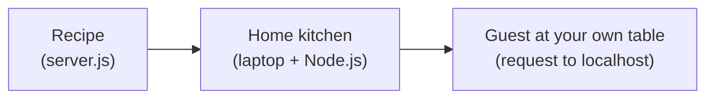
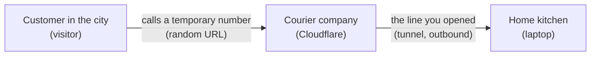
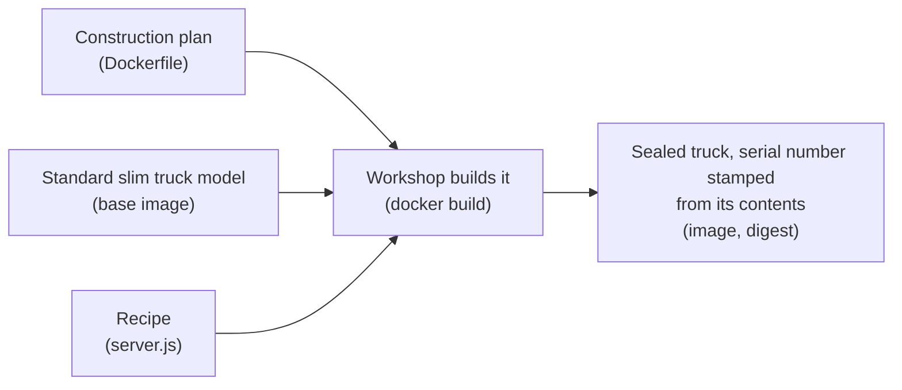
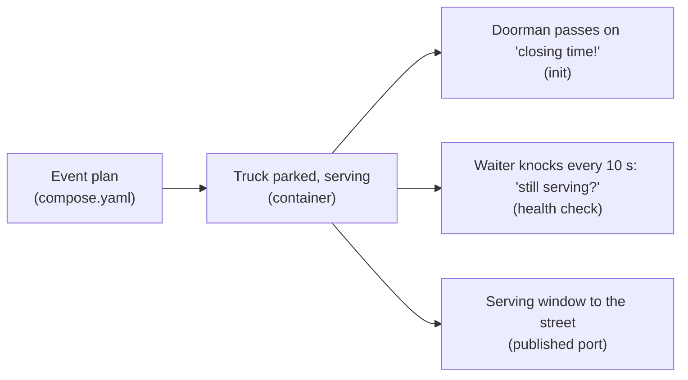
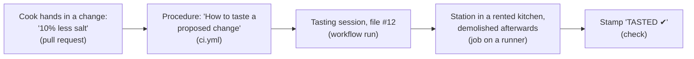
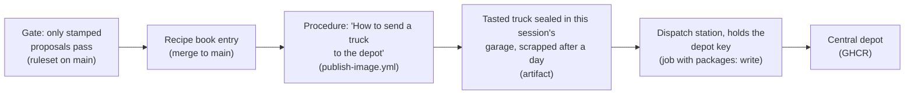
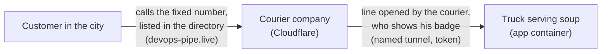
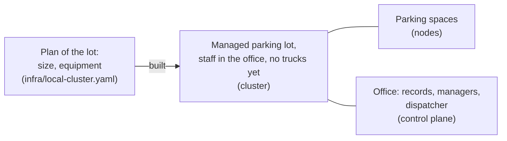
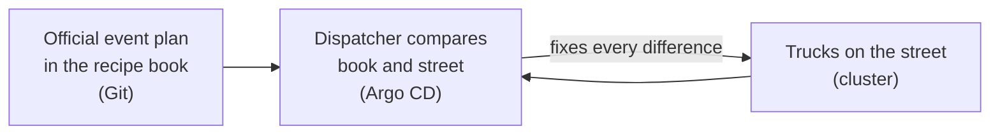

# The Analogy: A Soup Company

One analogy for the whole project, defined once. Other docs refer to it instead of re-explaining.

**The world:** a soup company that cooks a recipe and sells the soup from food trucks. Each diagram shows the analogy first, the technology in brackets.

Planned phases are marked *(planned)*.

---

## Phase 1: Local server

A recipe, cooked in a home kitchen, served at your own table.

---

## Phase 2: Public URL

You phone a courier company and keep the line open; they relay orders from anyone in the city down that line.

- **The number changes on every call:** the random `trycloudflare.com` URL.
- **Nobody comes into the house:** the line was opened from inside (no router ports opened).

---

## Phase 3: Container

### Building the truck

- **Build layers:** chassis, kitchen fit-out, soup station (image layers).
- **A sign at a parking spot, "today's soup truck",** which can be moved to a newer truck: a tag.

### Serving at an event

- **Trucks on one site call each other by name** over a private service road: the project network.
- **The event plan isn't part of the truck:** the same truck can be parked under different plans.

---

## Phase 4: Continuous integration

### Tasting a proposed recipe change

- **One line on the station's sheet,** "Taste: is it salted and hot?": a step.
- **A courier hired to bring the recipe book,** booked by ID card number, not "whoever the agency sends": an action pinned by SHA.

### Into the recipe book, out to the depot

---

## Phase 5: Production on the domain

- **The number never changes:** it's in the city's directory (DNS).
- **The badge:** whoever holds it can take the calls, so it stays locked away (`tunnel.env`, outside Git).
- **The street truck comes from the central depot, by serial number:** already tasted, never built in the owner's garage (the GHCR image by digest).

---

## Phase 6: Kubernetes and Helm

### The lot

- **Closing the lot for the night** keeps every truck inside: stopping the cluster.
- **Demolishing the lot** removes it and every truck on it; the plan remains: deleting the cluster.
- **The office's key** opens everything: the kubeconfig, never handed out.
- **The phone to the office:** asking "which spaces exist?", ordering "park two soup trucks" (`kubectl`). The office only takes orders from someone showing the owner's ID card (the kubeconfig).
- **More parking spaces, one office:** two extra spaces where trucks can park, but no office of their own; the office in the first space runs the whole lot (agent nodes, server node). All spaces sit on one plot of land: if the plot floods, every space is gone.
- **An order form handed to the office:** "one soup truck, of this exact serial number" (a manifest, `kubectl apply`). The office picks a free space and has the truck fetched from the depot and parked there (scheduler, kubelet, pod).
- **A private corridor from the owner's desk to that truck:** for tasting, not for customers (`kubectl port-forward`).
- **The fleet manager,** told "always keep 2 soup trucks serving," sends a new truck the moment one leaves, without asking why (Deployment, ReplicaSet). Each truck carries the company's sticker, so the manager knows which trucks are his to count (labels, selector).

### Planned

- **Shift change, one truck at a time,** so one is always serving: rolling update.
- **Fill-in-the-blanks event plan + one values sheet:** Helm chart, `values.yaml`.

---

## Phase 7: Continuous deployment *(planned)*

