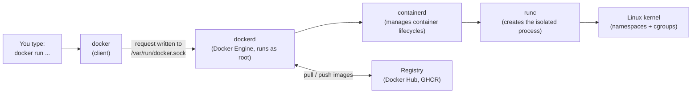
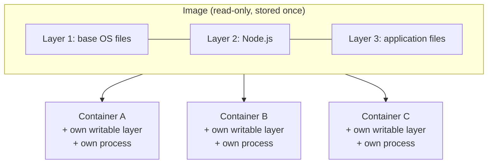
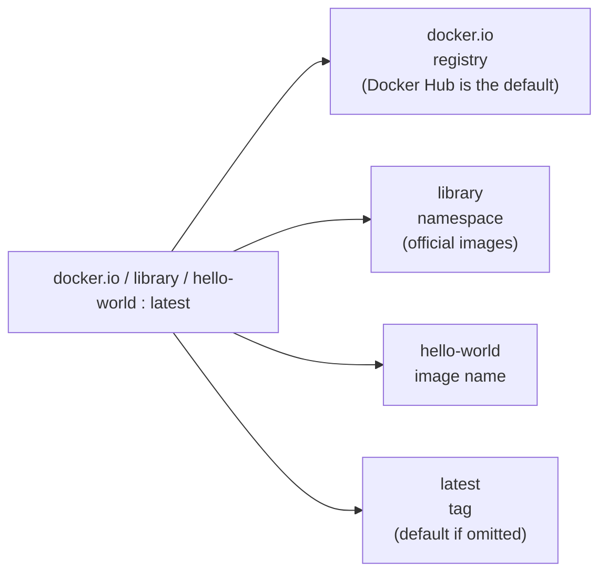
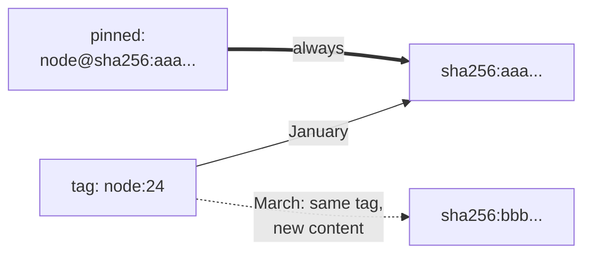
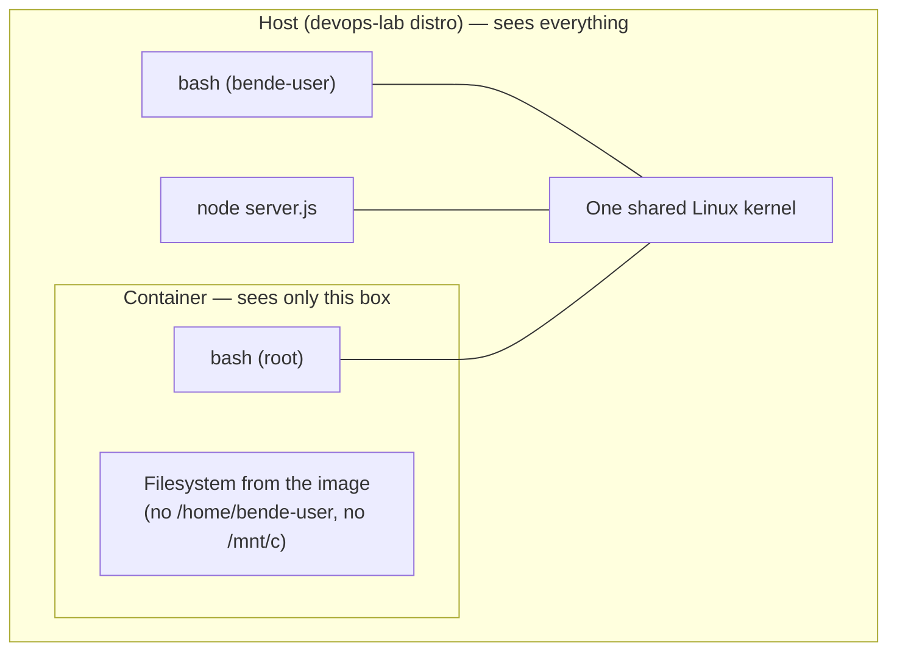
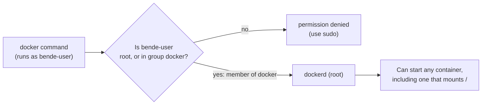
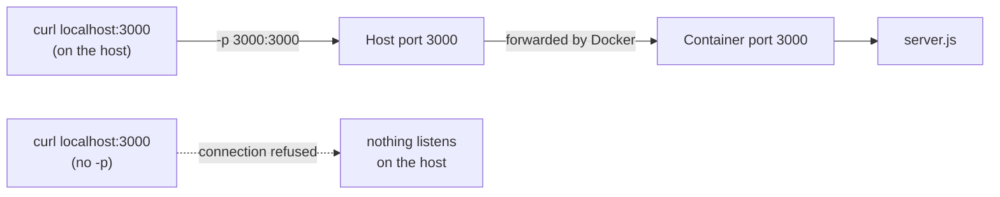
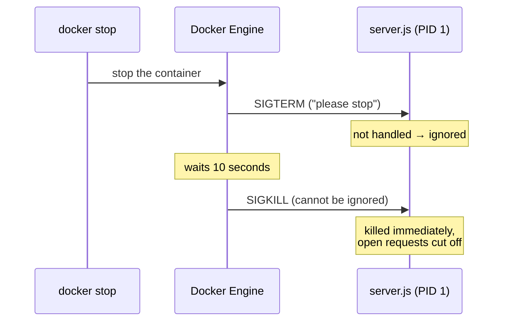
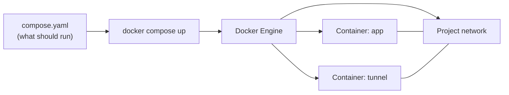
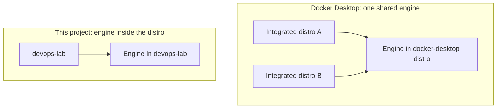

# Docker, Explained

This document explains what Docker is made of, what images and containers are, and how they relate to the host machine. It covers the concepts used in this repository; commands are shown only where they make a concept visible.

---

## 1. The pieces: who does what

Typing `docker` does not start containers by itself. The `docker` command is only a **client**: it sends requests to a background program, the **Docker Engine**, which does the actual work.



| Piece | What it is | Job |
|---|---|---|
| `docker` | The command-line client | Turns your command into a request and shows the response |
| `/var/run/docker.sock` | A **socket**: a special file two programs use to talk | The only door into the engine. Its file permissions decide who may use Docker |
| `dockerd` | The Docker Engine, a background service started by systemd | Stores images, creates networks, asks containerd to run containers, talks to registries |
| `containerd` | A lower-level service | Starts, stops, and watches containers |
| `runc` | A small program | Asks the kernel to create one isolated process, then exits |
| Linux kernel | The core of the operating system | Provides the isolation features that make a process a "container" |
| Registry | A server that stores images | Where images are downloaded from (**pull**) and uploaded to (**push**) |

`docker version` shows both halves: **Client** (the command) and **Server** (the engine). Seeing both proves the client can reach the engine.

---

## 2. Image and container

The two most important words in Docker:

- An **image** is a stored, read-only package: a complete filesystem (programs, libraries, files) plus instructions such as "which program to start" and "as which user". An image never runs and never changes.
- A **container** is **one run of an image**: a process started from the image's filesystem, with a thin **writable layer** on top for any files it creates or changes while it runs.



**Layers.** An image is a stack of layers. Each layer is a set of file changes, identified by its own hash. Images that share a layer (for example the same Ubuntu base) download and store it only once.

**Many containers, one image.** Any number of containers can run from the same image at once. Each has its own writable layer, so they don't see each other's changes. Deleting a container deletes its writable layer; the image is untouched.

**Containers are disposable.** Anything written inside a container is lost when the container is deleted (for example with `--rm`). Data that must survive lives outside the container (see section 6).

| | Image | Container |
|---|---|---|
| Is | A stored package | A running (or stopped) instance |
| Changes? | Never | Its writable layer does, while it exists |
| List | `docker image ls` | `docker ps` (running), `docker ps -a` (all) |
| Created by | `docker pull`, `docker build` | `docker run` |
| Removed by | `docker image rm` | `docker rm`, or automatically with `--rm` |

---

## 3. Image names, tags, and digests



- Typing `hello-world` means `docker.io/library/hello-world:latest`. Docker fills in the defaults.
- This project's images will live at `ghcr.io/<github-username>/devops-lab:<tag>`: another registry, another namespace.

**Tag vs digest.** A **tag** is a movable label. Whoever publishes the image can point `latest`, or even `24`, at different content at any time. A **digest** (`sha256:...`) is a hash of the image's exact content: it can never point at anything else.



That's why this project pins images **by digest**, the same idea as the integrity hashes in `package-lock.json`.

---

## 4. What a container actually is

A container is **not a virtual machine**. It's a normal Linux process that the kernel gives a restricted view of the system:

- **Namespaces** give the process its own view of: the filesystem (it sees the image, not the host's files), process IDs (it sees only its own processes), the network (its own network interface), the hostname, and users.
- **cgroups** (control groups) limit how much CPU, memory, and other resources it may use.



Consequences:

| Observation | Why |
|---|---|
| `uname -r` prints the **same kernel version** inside the container and on the host | There is only one kernel. Containers share it. A virtual machine would have its own. |
| `ps aux` on the host **shows the container's process** | It's a normal process on the host; only its *view* is restricted |
| Inside the container, the host's processes are **invisible** | The process namespace hides them. Isolation is one-way. |
| `/etc/os-release` inside says whatever the **image** contains | The "operating system" of a container is just the image's files. The kernel underneath is the host's. |
| Containers start in **milliseconds** | Nothing boots; the kernel just starts a process |

**Security consequence.** Because the kernel is shared, a container's isolation is weaker than a virtual machine's. And unless configured otherwise, **root inside a container is root on the host kernel**: the container's root process appears in the host's `ps aux` as `root`. Running images as a non-root user removes most of that risk.

---

## 5. Who may use Docker

Linux decides permissions by **user** and **group**. The socket `/var/run/docker.sock` belongs to user `root` and group `docker`, and only those two may read or write it:

```
srw-rw----  1 root docker  ...  /var/run/docker.sock
│└┬┘└┬┘└┬┘     │    │
│ │  │  │      │    └ group that owns the file
│ │  │  │      └ user that owns the file
│ │  │  └ everyone else: no access
│ │  └ members of group "docker": read + write
│ └ owner (root): read + write
└ s = socket
```



Adding a user to the `docker` group (`sudo usermod -aG docker $USER`) adds that user's name to the group's line in `/etc/group`. Group membership is read at login, so a new session is needed.

**Membership in `docker` is equivalent to root.** The engine runs as root and does what it's asked; one thing it can be asked is to start a container that mounts the host's entire filesystem, in which a root process can change any file. Every program running as a `docker` group member inherits that power. This project accepts that inside a distro dedicated to this project. **Rootless Docker**, where the engine itself runs without root, is the safer alternative and a possible later hardening step.

---

## 6. Mounts: giving a container access to host files

By default a container sees only its image's files. A **bind mount** (`-v /host/path:/container/path`) makes a host folder visible inside the container, in both directions: changes on either side are immediately visible on the other.


Mounts are how data outlives a container, and also how a container gets access it otherwise wouldn't have. Files created through a mount by a root process inside the container are **owned by root on the host**.

---

## 7. Networking: why a container needs published ports

A container gets its **own network** (a network namespace), with its own `localhost`. A server listening on port 3000 inside a container is listening on the *container's* port 3000, which the host can't reach.

**Publishing a port** (`-p host:container`) tells Docker to forward traffic from a port on the host into the container:



The two numbers don't have to match: `-p 8080:3000` makes the container's port 3000 reachable on the host's port 8080.

---

## 8. Stopping a container: process 1 and signals

Programs are asked to stop with **signals**: Ctrl+C sends `SIGINT`, `docker stop` sends `SIGTERM`. Normally a program that doesn't handle these simply exits.

Inside a container, the main program is **process 1** (PID 1), the first and only process. Linux treats PID 1 specially: **signals it doesn't explicitly handle are ignored.** A plain Node.js server doesn't handle them, so:



Fixes: run a tiny init process as PID 1 that forwards signals (`docker run --init`, which uses `docker-init`), or handle `SIGTERM` in the application and shut down cleanly. This matters for Kubernetes, which stops containers this way on every update.

---

## 9. Docker Compose: containers described in a file

`docker run` takes every setting as a command-line option, so the configuration exists only in someone's typing. **Docker Compose** moves those settings into a file, `compose.yaml`, and creates the containers it describes.



- **Declarative:** the file says *what* should exist (services, ports, settings), not the steps to create it. Compose works out the steps. Kubernetes and Helm use the same idea.
- **Services:** each entry under `services:` becomes a container. Its name is also its address on the project network.
- **Project network:** Compose creates a private network for the project's containers. They reach each other by service name (`http://app:3000`); `localhost` inside a container means that container itself.
- **One machine only:** Compose runs containers on a single engine. Spreading them over many machines, and restarting them anywhere, is what Kubernetes is for.
- **A plugin, not a new engine:** `docker compose` is an extension of the `docker` command and uses the same engine.

---

## 10. Where the engine runs (on WSL)



- **Docker Desktop** runs one engine that every integrated distro shares. They all see and control the same images and containers.
- This project installs Ubuntu's `docker.io` package **inside the `devops-lab` distro**, so its engine is isolated from any other environment.
- WSL appends the Windows `PATH` to Linux by default, which can make Docker Desktop's client visible inside the distro even when integration is off. This distro disables that (`appendWindowsPath = false` in `/etc/wsl.conf`).

---

## Command summary

| Command | What it does |
|---|---|
| `docker version` | Shows client and engine versions; proves they can talk |
| `docker run --rm <image>` | Creates a container from an image, runs it, deletes the container when it exits |
| `docker run --rm -it <image> bash` | Same, with an interactive shell inside (`-i` input open, `-t` terminal) |
| `docker run -v <host>:<container> ...` | Mounts a host folder into the container |
| `docker image ls` | Lists stored images |
| `docker ps` / `docker ps -a` | Lists running / all containers |
| `docker pull <image>` | Downloads an image without running it |
| `docker build -t <name> .` | Builds an image from the `Dockerfile` in the current folder (the build context) |
| `docker run -p 3000:3000 ...` | Publishes host port 3000 to container port 3000 |
| `docker exec <container> <command>` | Runs an extra command inside a running container |
| `docker stop <container>` | Sends `SIGTERM`; after 10 s, `SIGKILL` |
