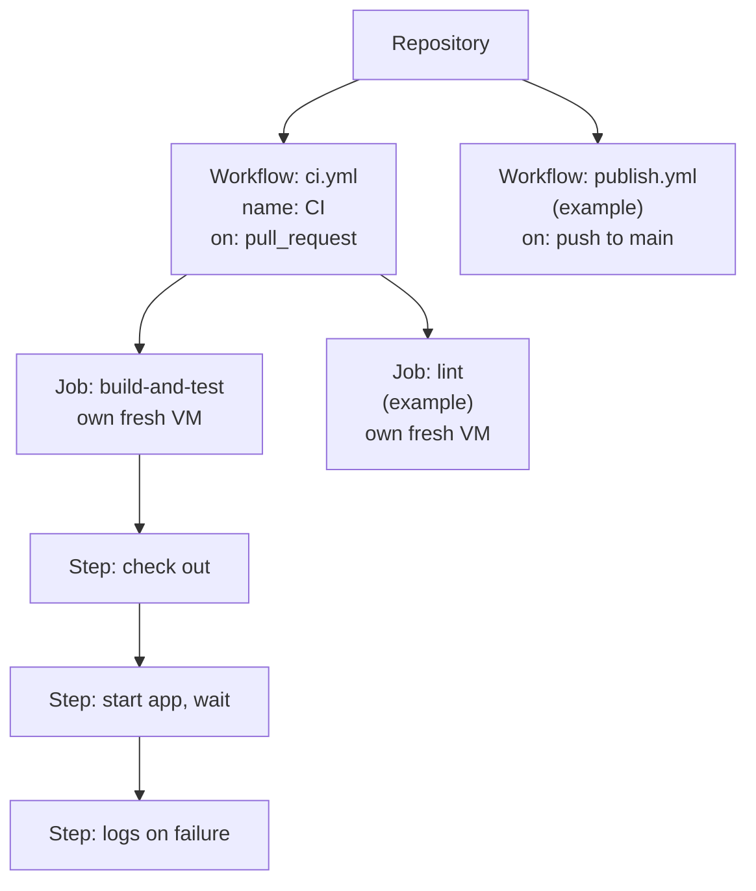

# GitHub Actions, Explained

How workflows, jobs, and steps fit together, and what they share. The workflow itself: [`.github/workflows/ci.yml`](../../.github/workflows/ci.yml).

## The hierarchy

- **Workflow:** one YAML file in `.github/workflows/`. A repository can have many, usually one per purpose or trigger.
- **`name:`** the workflow's display name in the Actions tab and on PR checks. Without it, GitHub shows the file path.
- **`on:`** the trigger: which event starts the workflow.
- **Job:** a group of steps on **its own fresh VM**. Jobs run in parallel unless `needs:` orders them. Each job is **one check** on a PR, named `<workflow> / <job>`.
- **Step:** one command (`run:`) or one reusable action (`uses:`). Steps of a job run one after another, on the same VM.

## What's shared

| | Steps in one job | Jobs in one workflow |
|---|---|---|
| Machine | Same VM | Different VMs |
| Files, Docker images, running containers | Shared | Not shared (passing files needs *artifacts*) |
| Shell variables | Not shared: each step is its own shell | Not shared |
| Order | Sequential; a failure skips the rest, unless `if: failure()` or `always()` | Parallel, unless `needs:` |
| Token permissions | The job's | Per workflow, adjustable per job |
| Result on the PR | One check together | One check each |

## The runner

- **A fresh virtual machine** created for each job and deleted afterwards. Nothing carries over between runs.
- **Managed by GitHub:** updated weekly; `runs-on: ubuntu-24.04` fixes only the OS version.
- **Free for public repositories.**

## Where something new goes

| New thing | Goes in | Because |
|---|---|---|
| Needs what earlier steps produced (e.g. a test against the running app) | A **step** in the same job | Same VM, same files, same containers |
| Independent, own pass/fail (e.g. a linter) | A **job** | Runs in parallel; own check |
| Needs different permissions | A **job** | Permissions can be set per job: least privilege |
| Different trigger (e.g. publishing on merge to `main`) | A **workflow** | Different event; pull-request runs never get its permissions |

## Security basics

- **`permissions:`** limits the automatic token (`GITHUB_TOKEN`). Default here: read-only.
- **Actions are third-party code:** pinned by full commit SHA, with the version as a comment.
- **`timeout-minutes:`** caps a job; the default is 6 hours.