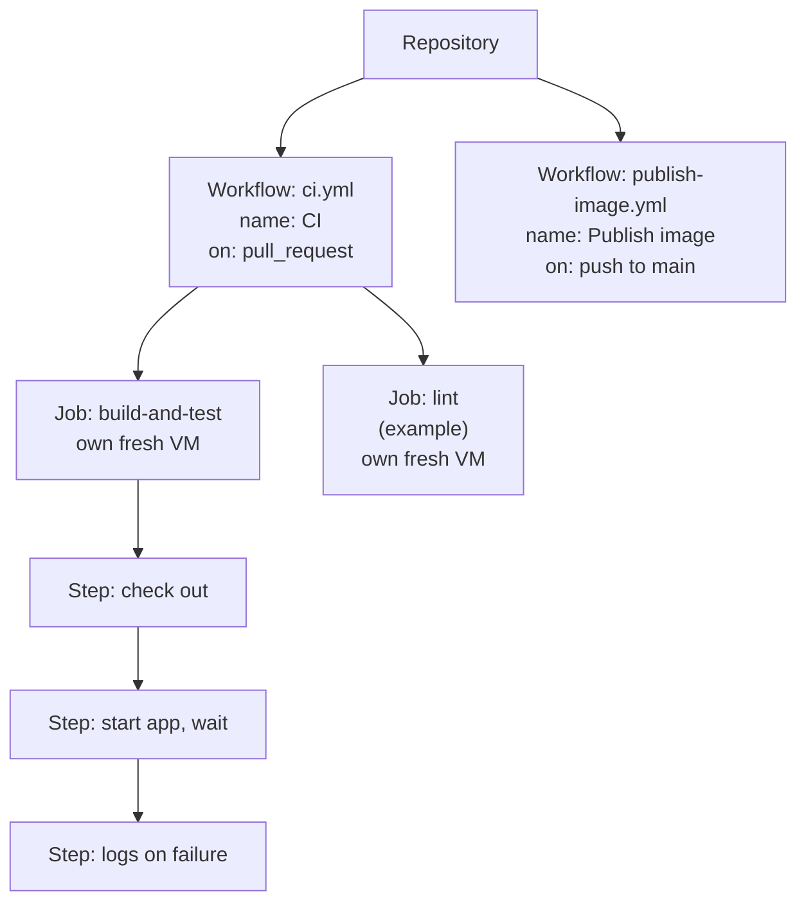

# GitHub Actions, Explained

How workflows, jobs, and steps fit together, and what they share. The workflow itself: [.github/workflows/ci.yml](../../.github/workflows/ci.yml).

## Vocabulary

| Term | What it is | Example |
|---|---|---|
| **Event** | Something that happens on GitHub | A pull request opened; a push to `main` |
| **Workflow** | A YAML file in `.github/workflows/`: what to do, and on which events | `ci.yml`, `publish-image.yml` |
| **Workflow run** | One execution of a workflow, started by one event; has a number and its own page | "Publish image #12" |
| **Job** | One part of a run, on its own fresh VM | `build-and-test` |
| **Runner** | The VM that executes a job; deleted afterwards | `ubuntu-24.04` |
| **Step** | One command (`run:`) or one action (`uses:`) in a job | "Run the smoke test" |
| **Action** | Reusable step code, published by someone | `actions/checkout` |
| **Check** | A job's result on a pull request or commit | **CI / build-and-test** |
| **Artifact** | A file a job uploads, attached to its workflow run, surviving the VM | `devops-lab-app-image` |

## The hierarchy



- **Workflow:** one YAML file in `.github/workflows/`. A repository can have many, usually one per purpose or trigger.
- **`name:`** the workflow's display name in the Actions tab and on PR checks. Without it, GitHub shows the file path.
- **`on:`** the trigger: which event starts the workflow.
- **Job:** a group of steps on **its own fresh VM**. Jobs run in parallel unless `needs:` orders them. Each job is **one check** on a PR, named `<workflow> / <job>`.
- **Step:** one command (`run:`) or one reusable action (`uses:`). Steps of a job run one after another, on the same VM.

## What's shared

| | Steps in one job | Jobs in one workflow |
|---|---|---|
| Machine | Same VM | Different VMs |
| Files, Docker images, running containers | Shared | Not shared (passing files needs *artifacts*) |
| Shell variables | Not shared: each step is its own shell | Not shared |
| Order | Sequential; a failure skips the rest, unless `if: failure()` or `always()` | Parallel, unless `needs:` |
| Token permissions | The job's | Per workflow, adjustable per job |
| Result on the PR | One check together | One check each |

## Reusable workflows

A workflow with the trigger `on: workflow_call` can be **called** by other workflows, like a function.

```yaml
jobs:
  ci:
    uses: ./.github/workflows/ci.yml
```

- **The caller's job has no `runs-on` and no `steps`:** the called workflow brings its own jobs.
- **Shown as** `<caller job> / <called job>`, for example **ci / build-and-test**.
- **Permissions:** the caller sets the maximum; the called workflow can only reduce them.
- **Why:** steps defined once can't drift apart between workflows.
- **Inputs:** a reusable workflow can declare parameters under `workflow_call: inputs:`; callers pass them with `with:`. When the workflow runs from its own trigger (no caller), inputs are empty, which counts as false.

## Artifacts

Files a job uploads to GitHub's storage, attached to its workflow run.

```yaml
      - uses: actions/upload-artifact@<SHA>  # <version>
        with:
          name: devops-lab-app-image
          path: devops-lab-app.tar
          retention-days: 1
```

- **Survive the VM:** the runner is deleted; the artifact stays until its retention period ends (default: 90 days).
- **Shared within a run:** later jobs of the same run can download it (`actions/download-artifact`).
- **Visible on the run's page,** where people can download it.
- **Need no `permissions:`:** uploading uses a short-lived token scoped to the run.

## The runner

- **A fresh virtual machine** created for each job and deleted afterwards. Nothing carries over between runs.
- **Managed by GitHub:** updated weekly; `runs-on: ubuntu-24.04` fixes only the OS version.
- **Free for public repositories.**

## Where something new goes

| New thing | Goes in | Because |
|---|---|---|
| Needs what earlier steps produced (e.g. a test against the running app) | A **step** in the same job | Same VM, same files, same containers |
| Independent, own pass/fail (e.g. a linter) | A **job** | Runs in parallel; own check |
| Needs different permissions | A **job** | Permissions can be set per job: least privilege |
| Different trigger (e.g. publishing on merge to `main`) | A **workflow** | Different event; pull-request runs never get its permissions |

## Security basics

- **`permissions:`** limits the automatic token (`GITHUB_TOKEN`). Default here: read-only.
- **Actions are third-party code:** pinned by full commit SHA, with the version as a comment.
- **`timeout-minutes:`** caps a job; the default is 6 hours.