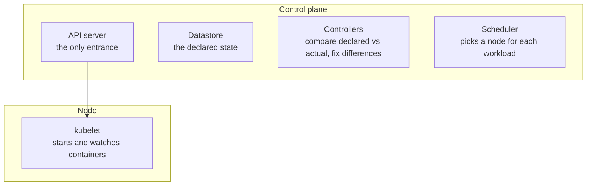

# Kubernetes, Explained

What Kubernetes is made of, built up one concept at a time. Commands: [cheatsheets/kubernetes.md](../cheatsheets/kubernetes.md).

## 1. The cluster

A **cluster** is a set of machines (**nodes**) plus a **control plane** that decides what runs where, and keeps it that way.

- **Declared state:** you tell the API server *what* should run; the controllers make it so, and keep it so.
- **Nodes** run the workloads; the **kubelet** on each node is the local worker.
- **Even empty,** a cluster runs: the control plane waits for instructions, and Kubernetes runs a few helpers of its own (cluster DNS, resource metrics, storage).

## 2. A cluster is not an image

| | Image | Container | Cluster |
|---|---|---|---|
| Created from | `Dockerfile` | An image | A blueprint (here `infra/local-cluster.yaml`) |
| Changes over time | Never | Its writable layer | Yes: everything deployed into it |
| Stop / start | — | `docker stop` / `start` | `k3d cluster stop` / `start` |
| Delete | `docker image rm` | `docker rm` | `k3d cluster delete`: everything inside is gone |

- **Stopped:** the nodes don't run; no CPU, no memory; everything inside is kept.
- **Deleted:** the nodes and everything inside are gone; the blueprint can build an empty one again.

## 3. This project's cluster

- **k3s:** a lightweight Kubernetes distribution.
- **k3d:** runs k3s with each node as a Docker container.
- **Blueprint:** [`infra/local-cluster.yaml`](../../infra/local-cluster.yaml), in the repo.
- **Credentials:** `~/.kube/config`, written by k3d, never in the repo. Whoever has it controls the cluster.

## 4. `kubectl` and the kubeconfig

- **`kubectl`** is the command-line client for the API server: it turns commands into HTTPS requests, and the answers into tables.
- **The kubeconfig** (`~/.kube/config`) tells it where the API server is, and holds the credential it presents. The API server answers only clients that prove who they are.
- **Contexts:** the file can describe several clusters; the **current context** selects which one `kubectl` talks to.

## 5. Server and agent nodes

- **Server nodes** run the control plane (and, in k3s, workloads too).
- **Agent nodes** run workloads only. Their kubelet joins the cluster with the API server's address and a **join token**, and from then on reports its state and takes work.
- **`kubectl` never talks to nodes:** it talks to the API server, which hands work to the kubelets. One `kubectl` controls 3 nodes or 3,000 the same way.
- **In production,** each node is its own machine: self-managed servers or virtual machines, or a cloud provider's managed cluster, where the provider runs the control plane and the team rents worker machines.
- **This project:** three real nodes, sharing one machine.