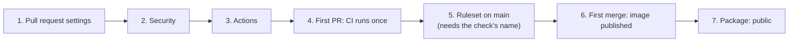

# Configure the GitHub Repository

**Result:** `main` accepts only reviewed, passing changes; only chosen, pinned actions run; secrets are blocked before they're pushed; the published image is public.

These settings live in GitHub, **not in Git**: this page is both the procedure and the record. Change both together.

## Steps

Some settings depend on things that exist only after the first workflow runs, so the order matters:



1. **Pull request settings:** **Settings → General → Pull Requests**, as in the table below.
2. **Security:** **Settings → Advanced Security**: secret scanning and push protection on.
3. **Actions:** **Settings → Actions → General**, as in the table below. The allowed-actions field is a comma-separated list.
4. **Open a first pull request,** so the CI check `build-and-test` runs once. The ruleset can only require a check GitHub has seen.
5. **Ruleset:** **Settings → Rules → Rulesets → New branch ruleset**, as in the table below. Leave the bypass list **empty**.
6. **Merge,** so the first image is published to GHCR.
7. **Package:** **Repository → Packages → `devops-lab` → Package settings**: visibility public, connected to the repository.
8. **Verify** (below).

## Settings at a glance

### Ruleset `protect-main`

**Settings → Rules → Rulesets**

| Setting | Value | Why |
|---|---|---|
| Enforcement status | Active | |
| Bypass list | Empty | The rules apply to everyone, including the owner |
| Target | Default branch (`main`) | |
| Restrict deletions | On | `main` can't be deleted |
| Block force pushes | On | `main`'s history can't be rewritten |
| Require a pull request before merging | On | Every change goes through a PR |
| → Required approvals | 0 | A single owner can't approve their own PRs; 1 would block every merge |
| → Dismiss stale approvals when new commits are pushed | On | No effect at 0 approvals; correct default if collaborators join |
| → Allowed merge methods | Merge | Merge commits only (project convention) |
| Require status checks to pass | On | CI must pass before merging |
| → Required check | `build-and-test` | The job in `.github/workflows/ci.yml` |
| → Require branches to be up to date | On | The check must have run against the latest `main` |

**Renaming the CI job** changes the check's name. The ruleset would then wait forever for a check called `build-and-test` that never comes, and every PR would be blocked. Update the ruleset in the same change.

### Pull requests

**Settings → General → Pull Requests**

| Setting | Value | Why |
|---|---|---|
| Allow merge commits | On | Project convention |
| Allow squash merging | Off | |
| Allow rebase merging | Off | |
| Always suggest updating pull request branches | On | "Update branch" button when `main` has moved on |
| Automatically delete head branches | On | Merged branches are removed from GitHub |

Locally, `git config --global fetch.prune true` removes references to deleted branches on the next fetch.

### Security

**Settings → Advanced Security**

| Setting | Value | Why |
|---|---|---|
| Secret scanning | On | Detects tokens and keys in the repository |
| Push protection | On | **Blocks a push** containing something that looks like a secret, before it becomes public |

### Actions

**Settings → Actions → General**

| Setting | Value | Why |
|---|---|---|
| Actions permissions | Allow owner's, and select non-owner, actions and reusable workflows | Only chosen actions can run |
| → Allow actions created by GitHub | Off | The explicit list below is stricter |
| → Allow actions by Marketplace verified creators | Off | |
| → Allowed actions | `actions/checkout@*`, `actions/upload-artifact@*`, `actions/download-artifact@*` | Adding a new action is a deliberate settings change |
| Require actions to be pinned to a full-length commit SHA | On | A workflow using a tag (`@v7`) fails |
| Approval for running fork pull request workflows | Require approval for all external contributors | No outside pull request runs a workflow without the owner's approval |
| Workflow permissions | Read repository contents and packages permissions | The default token is read-only; jobs request more explicitly |
| Allow GitHub Actions to create and approve pull requests | Off | A workflow must never approve its own changes |
| Artifact and log retention | 90 days (default) | Individual artifacts can set less (`retention-days`) |

### Packages

**Repository → Packages → `devops-lab` → Package settings**

| Setting | Value | Why |
|---|---|---|
| Visibility | Public | The image contains no secrets; anything can pull it without credentials |
| Connected repository | `devops-lab` | Links the package to its source and workflows |

## Verify

```bash
git switch main && git pull
git commit --allow-empty -m "Test: main rejects direct pushes"
git push                       # rejected: repository rule violations
git reset --hard origin/main   # discard the local test commit
```

```bash
docker logout ghcr.io
docker pull ghcr.io/bende-kbb/devops-lab:sha-<commit SHA>   # works without credentials: the package is public
```

## Limitations

- **Settings live in the GitHub UI:** no review, no history, nothing to restore from. Terraform's GitHub provider could manage them as code.
