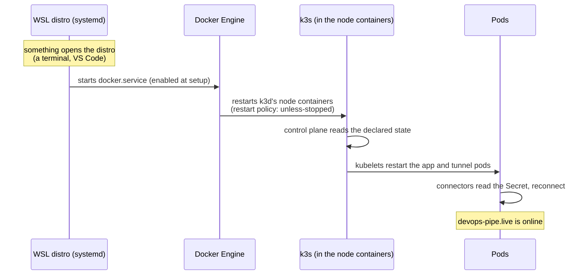

# Run Production

**Production:** the local k3d cluster serves `https://devops-pipe.live`: 2 app pods behind the Service `app` (the Helm release `devops-lab`) and 2 tunnel connectors.

## Start and stop

```bash
k3d cluster start devops-lab
kubectl get pods --watch            # wait until all 4 pods stay 1/1 Running
curl -i https://devops-pipe.live    # 200 Hello world
k3d cluster stop devops-lab         # the site goes offline (Cloudflare error 1033 / 530)
```

**After `start`,** pods can show `Unknown`, `Pending`, or climbing `RESTARTS` for a minute while the nodes reconnect. Wait until the list stays stable.

## What starts by itself

Nothing needs to be typed after a reboot: when the distro starts, the chain below brings the site back, unless the cluster was stopped with `k3d cluster stop`.



- **Windows alone doesn't start the distro;** something has to open it.
- **`unless-stopped`:** Docker restarts these containers whenever the engine starts, except after a deliberate stop.
- **Kubernetes is the orchestrator;** Helm and kubectl are clients that run only when typed, to change the declared state.

```bash
systemctl is-enabled docker                                                     # enabled
docker inspect -f '{{.HostConfig.RestartPolicy.Name}}' k3d-devops-lab-server-0  # unless-stopped
```

## Deploy a new version

1. Merge a change: CI publishes `ghcr.io/bende-kbb/devops-lab:sha-<commit>`; the digest is on the **Publish image** run's Summary page.
2. Pull request: put `sha-<commit>@sha256:<digest>` into `charts/devops-lab/values.yaml`; merge.
3. Apply:

```bash
git switch main && git pull
helm upgrade devops-lab charts/devops-lab
kubectl rollout status deployment/app      # successfully rolled out: no downtime
```

**Undo:** `helm history devops-lab`, then `helm rollback devops-lab <revision>`.

## First-time setup on a new machine

Prerequisites: [set up the development machine](set-up-the-development-machine.md), and `tunnel.env` from [set up the domain and tunnel](set-up-the-domain-and-tunnel.md).

```bash
k3d cluster create --config infra/local-cluster.yaml
kubectl create secret generic tunnel-token --from-env-file=tunnel.env
helm upgrade --install devops-lab charts/devops-lab
kubectl apply -f kubernetes/tunnel-deployment.yaml
kubectl get pods --watch
```

## Fallback: Compose

If the cluster can't run, Compose can serve the same domain. **Never run both:** stop the cluster first.

```bash
k3d cluster stop devops-lab
docker compose -f compose.yaml -f compose.production.yaml up -d --wait
docker compose -f compose.yaml -f compose.production.yaml down    # both files on every command
```

`compose.production.yaml` pins its own image digest, which may be older than `values.yaml`.

## Before a demo

- Start the cluster early; wait until the pods are stable.
- Images are cached on the nodes: the registry isn't needed while nothing changes.
- Networks can block the tunnel or `ghcr.io`: keep a phone hotspot as a fallback.

Commands and errors: [Kubernetes cheat sheet](../cheatsheets/kubernetes.md).
