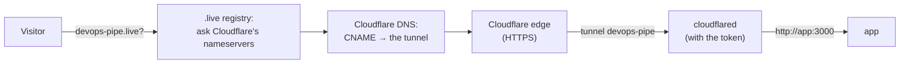

# Set Up the Domain and the Tunnel

**Result:** `https://devops-pipe.live` reaches the app through a Cloudflare named tunnel. No router ports are opened.

These settings live in name.com and Cloudflare, **not in Git**: this page is both the procedure and the record. Change both together.



## Before you start

- **Accounts:** name.com and Cloudflare, each with **two-factor authentication** on. Whoever controls these accounts controls where the domain points.
- **Time:** the nameserver change takes from minutes up to 48 hours to spread.

## Steps

### 1. Register the domain (name.com)

- Through the GitHub Student Developer Pack offer (one free year), or by purchase. The OAuth authorization for the offer asks for **public data only**.
- **Contact details:** real ones (required by the domain system; false details risk suspension). **Organization:** empty. **WHOIS privacy:** on.
- **Automatic renewal:** off; put the expiry date in a calendar, so letting it expire is a decision.
- **No email on this domain,** and never use it as an account's login email: an expired domain's new owner would receive that mail.

### 2. Add the domain to Cloudflare

**Cloudflare dashboard → Add a domain** → `devops-pipe.live` → **Quick scan for DNS records** → **Free** plan.

Delete every imported record (name.com's parking page: `A` records for `*`, the bare domain and `www`). The domain should point nowhere until the tunnel's route exists. Note the **two nameservers** Cloudflare shows.

### 3. Check that DNSSEC is off

```bash
dig DS devops-pipe.live +short
```

**Expected: no output.** A DS record would break the domain during the nameserver change. (`dig` comes with `sudo apt install -y dnsutils`.)

### 4. Switch the nameservers (name.com)

**Manage Nameservers:** delete name.com's four, add Cloudflare's two (`mckenzie.ns.cloudflare.com`, `todd.ns.cloudflare.com`), save.

### 5. Wait until Cloudflare says Active

```bash
dig NS devops-pipe.live +short   # Cloudflare's two nameservers once it has spread
```

Cloudflare also emails when the domain is **Active**.

### 6. Lock the domain (name.com)

**Domain Lock Plus:** on. Settings, nameservers included, can't change without unlocking first.

### 7. Create the tunnel (Cloudflare Zero Trust)

- **Zero Trust:** first visit asks for a team name and a plan: **Free**. A payment method is required even for the free plan; enable nothing paid.
- **Networks → Tunnels → Create a tunnel → Cloudflared**, name `devops-pipe`.
- On the connector page, choose **Docker** and copy **only the token** (the string after `--token`). Don't run the shown command.

### 8. Store the token

Create `tunnel.env` in the repository folder **with an editor** (a command like `echo` would save the token in the shell history):

```
TUNNEL_TOKEN=<token>
```

```bash
chmod 600 tunnel.env              # readable only by you
git check-ignore -v tunnel.env    # .gitignore:2:tunnel.env  tunnel.env
```

`tunnel.env` is in `.gitignore`; push protection is the second line of defense.

### 9. Start a connector

The dashboard enables the next step only once a connector is online. In the cluster (normal production):

```bash
kubectl create secret generic tunnel-token --from-env-file=tunnel.env
kubectl apply -f kubernetes/tunnel-deployment.yaml
kubectl logs deployment/tunnel | grep "Registered tunnel connection"
```

### 10. Add the route

**The tunnel → Routes → Add route → Published application:**

| Field | Value | Why |
|---|---|---|
| Subdomain | empty | The bare domain |
| Domain | `devops-pipe.live` | |
| Path | empty | Everything |
| Service URL | `http://app:3000` | Plain HTTP: HTTPS ends at Cloudflare's edge. `app:3000` is the app as seen from the connector (Service or Compose service name, and its port) |
| Additional settings | defaults | |

Cloudflare creates the matching DNS record automatically.

### 11. Verify

```bash
curl -i https://devops-pipe.live   # HTTP/2 200, Hello world
```

## Settings at a glance

### name.com

| Setting | Value |
|---|---|
| Domain | `devops-pipe.live`, expires 2027-11-15 |
| Automatic renewal | Off |
| WHOIS privacy | On |
| Transfer lock | On |
| Domain Lock Plus | On |
| Nameservers | `mckenzie.ns.cloudflare.com`, `todd.ns.cloudflare.com` |
| Account | Two-factor authentication on |

### Cloudflare

| Setting | Value |
|---|---|
| Plan | Free (zone); Zero Trust Free (payment method on file, nothing paid enabled) |
| DNS records | Only `CNAME devops-pipe.live` → `<tunnel-id>.cfargotunnel.com`, proxied, created by the route |
| Tunnel | `devops-pipe`, dashboard-managed |
| Route | `devops-pipe.live` → `http://app:3000`, default settings |
| Account | Two-factor authentication on |

### The token

| Where | How it's protected |
|---|---|
| `tunnel.env` (repository folder) | Ignored by Git, `chmod 600` |
| Kubernetes Secret `tunnel-token` | Readable by anyone with the kubeconfig; never print it (`-o yaml`) |

## Rotating the token

After a leak or a lost laptop:

1. The tunnel's settings in the dashboard → rotate the token; copy the new one.
2. Replace the line in `tunnel.env`.
3. Replace the Secret and restart the connectors:

```bash
kubectl delete secret tunnel-token
kubectl create secret generic tunnel-token --from-env-file=tunnel.env
kubectl rollout restart deployment/tunnel
```

## Limitations

- **Settings live in web interfaces:** no review, no history, nothing to restore from. Terraform's Cloudflare provider could manage them as code.
- **The token sits on one laptop,** and in the cluster's Secret.
