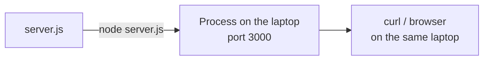

# Phase 1: Local Server

## Problem
A delivery pipeline needs something to deliver.

## Solution
The smallest working HTTP server: one plain JavaScript file using Node.js's built-in `node:http` module. No frameworks, no dependencies, no build step.

## What we tested
Running plain JavaScript with nothing but Node.js:

| Experiment | Result | Lesson |
|---|---|---|
| No status or headers set | `200 OK` with `Date`, `Connection`, `Content-Length`, but **no `Content-Type`** | Defaults work but are incomplete HTTP; `Content-Type` was added explicitly |
| Edit the file while it runs | Old response until restart | A process reads its code once, at startup |
| Start a second server | `EADDRINUSE`: port already in use | One port, one listener |
| Typo `response.ennd` | Starts fine; the **first request crashes the whole server** | JavaScript finds such mistakes only at runtime |
| Unknown path or method | Same `200 Hello world` | No routing (out of scope) |

## Cost
Almost none: one file and a runtime.

## Limitations
- Reachable only from the laptop.
- Every step manual; port hard-coded.
- Mistakes appear only at runtime and take the server down.
