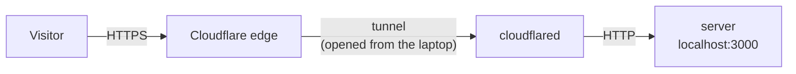
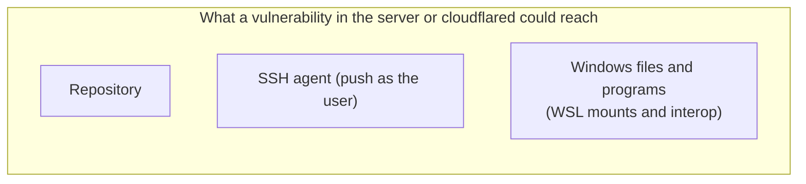

# Phase 2: Public URL (Walking Skeleton)

## Problem
The server is reachable only from the laptop.

## Why now
A **walking skeleton** builds the thinnest path from code to users first, then hardens each stage. The whole pipeline is visible early, and the biggest risk, "can it be reached at all?", is answered first.

## Solution
A Cloudflare **quick tunnel**. The router blocks incoming connections but allows outgoing ones, so `cloudflared` on the laptop opens connections **out** to Cloudflare and keeps them open. Visitors' requests travel back down those connections. No router changes, no account, no domain.

## Cost and trade-offs

- **Exposed to the whole internet:** acceptable only because the server has nothing to protect.
- **Cloudflare decrypts the traffic:** it can read and modify it. A trust decision.
- **Code execution reaches far:** both programs run as the laptop user. The dedicated distro prevents accidents, not attacks.
- **A random URL is not access control.**

Full analysis: [quick tunnel analysis](quick-tunnel-analysis.md).

## Limitations
- The URL is random and changes on every restart.
- Two terminals must stay open; offline when the laptop sleeps.
- Still runs from the source folder, on a machine with Node.js.
