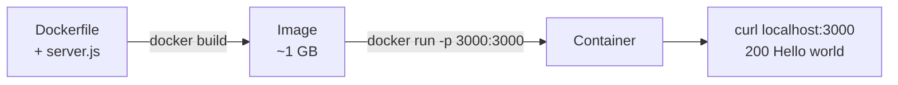

# Step 1: The Naive Image

[← Phase 3](README.md)

## Problem

The app needs Node.js installed on the host and runs from the source folder.

## Change

The simplest `Dockerfile` that works:

```dockerfile
FROM node:24
COPY server.js .
CMD ["node", "server.js"]
```

| Line | Meaning |
|---|---|
| `FROM node:24` | Start from the official Node.js 24 image (Debian + Node.js) |
| `COPY server.js .` | Copy the server into the image |
| `CMD ["node", "server.js"]` | The command a container runs when it starts |



## What we tested

| Experiment | Result | Lesson |
|---|---|---|
| `docker run node:24 node -v` | v24.22.2 (host has v24.22.1) | The container brings its own runtime; `node:24` is a **movable tag** |
| Shell in `ubuntu:26.04`: `ls /home`, `ls /mnt` | No user home, no Windows drive | A container sees only its image's files |
| `uname -r` inside and outside | Same kernel | A container is **not a virtual machine** |
| `ps aux` on the host | The container's shell is visible, as **root** | A container is a restricted process; root inside is root on the kernel |
| Mount a folder, create a file | File appears on the host, owned by root | Host access only through explicit mounts |
| `docker run` without `-p`, then `curl` | Connection refused | A container has **its own network** |
| `docker run -p 3000:3000`, then `curl` | `200 Hello world` | Publishing a port connects host and container |
| Ctrl+C on the running container | Nothing happens | The server is **process 1**; unhandled stop signals are ignored |
| `time docker stop` | ~10 seconds | Docker asks politely, waits 10 s, then kills |
| `docker exec ... whoami` | `root` | The image never names a user |

## What's wrong with the naive image

Deliberately the simplest that works. Its problems were observed, not assumed. This table describes the naive image and stays as it is; fixes are tracked in [result.md](result.md).

| Problem | Consequence |
|---|---|
| ~1 GB for a few hundred bytes of code | Slow to move; large attack surface |
| Runs as root | A server bug is a root process on the shared kernel |
| Ignores stop signals | Every stop waits 10 s, then a forced kill |
| App copied into `/` | Mixed in with operating system files |
| Movable base tag `node:24` | A rebuild can silently produce a different image |
| Long `docker run` command | Settings exist only in someone's typing |
