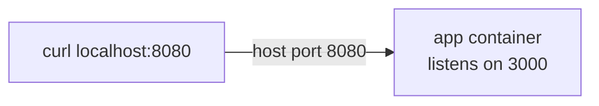

# Step 2: Docker Compose

[← Phase 3](README.md)

## Problem

Running the app means typing `docker run --rm --name devops-lab -p 3000:3000 devops-lab`. The settings live only in commands: easy to mistype, impossible to review.

## Change

The same settings, written in `compose.yaml`:

```yaml
services:
  app:
    build: .
    ports:
      - "8080:3000"
```

| Line | Meaning |
|---|---|
| `services:` | The containers this project runs |
| `app:` | Service name; also its address on the project network |
| `build: .` | Build the image from `./Dockerfile` (named `devops-lab-app`) |
| `"8080:3000"` | Host port 8080 → container port 3000. Different numbers make it visible which side is which. Quoted, because YAML can misread unquoted `number:number` |

**Declarative:** the file says *what* should run, not the steps. Kubernetes and Helm work the same way.



## Before and after

| | Before | After |
|---|---|---|
| Start | `docker build -t devops-lab .` then `docker run --rm --name devops-lab -p 3000:3000 devops-lab` | `docker compose up -d --build` |
| Terminal | Busy while the app runs | Free (`-d` runs it in the background) |
| Stop | `docker stop devops-lab` | `docker compose down` |
| Settings | In the command | In `compose.yaml`, versioned and reviewed |

## Verify

```bash
docker compose up -d --build
docker compose ps                 # app: Up
curl -i http://localhost:8080     # 200 Hello world
curl -i http://localhost:3000     # connection refused: not published
time docker compose down          # still ~10 s: fixed in step 3
```
