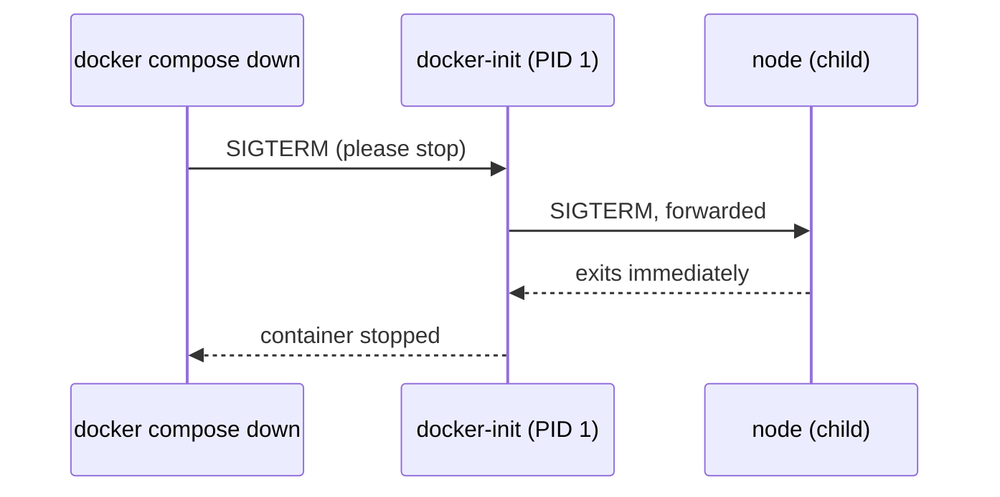

# Step 3: Init Process

[← Phase 3](README.md)

## Problem

Every stop takes about 10 seconds and ends with the app being killed. Inside the container, Node.js is **process 1**, and Linux ignores stop signals sent to process 1 unless the program handles them itself. Ours doesn't.

## Change

One line in `compose.yaml`:

```yaml
services:
  app:
    build: .
    init: true
    ports:
      - "8080:3000"
```

`init: true` makes Docker start a tiny helper, `docker-init`, as process 1, with Node.js as its child. The helper handles signals: it forwards the stop signal to Node.js, which is no longer process 1 and exits normally.



Without `init`, the same request goes straight to Node.js as PID 1, is ignored, and after 10 seconds Docker sends `SIGKILL`.

## Before and after

| | Before | After |
|---|---|---|
| Process 1 in the container | `node` | `docker-init` |
| `time docker compose down` | ≈ 10 s | ≈ 1 s |
| How the app ends | Killed (`SIGKILL`) | Stops on request (`SIGTERM`) |

This matters later: Kubernetes stops containers the same way on every update.

## Verify

```bash
docker compose up -d
docker compose exec app ps -o pid,comm    # PID 1: docker-init (or init); node has another PID
time docker compose down                  # ≈ 1 s
```
