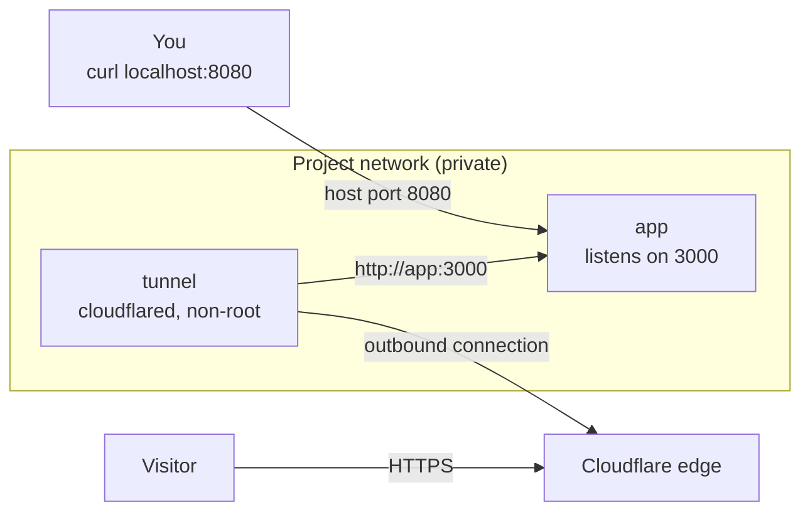
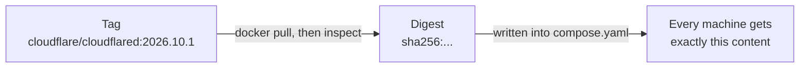
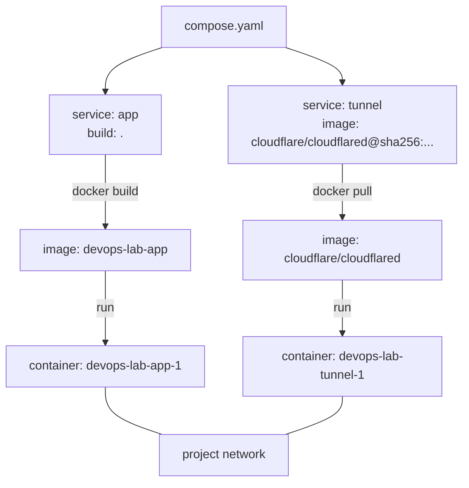

# Step 4: Tunnel in a Container

[← Phase 3](README.md)

## Problem

1. **Two terminals:** the app runs in the background, but `cloudflared` still runs in the foreground in a second terminal. Close it and the site is down.
2. **cloudflared runs as the Linux user:** a vulnerability in it could reach the SSH agent, the repository, and Windows files (risk 3 in the [tunnel analysis](../phase-2-public-url/quick-tunnel-analysis.md)).

## Change

A second service in `compose.yaml`, using Cloudflare's official image, pinned by digest:

```yaml
  tunnel:
    image: cloudflare/cloudflared@sha256:<digest>   # 2026.10.1
    command: ["tunnel", "--url", "http://app:3000"]
    depends_on:
      - app
```

| Line | Meaning |
|---|---|
| `image: ...@sha256:...` | Exactly this image: version 2026.10.1, referenced by its content hash so it can't be swapped |
| `command:` | Arguments for the image's built-in program. The image already starts `cloudflared --no-autoupdate`; we add `tunnel --url http://app:3000` |
| `http://app:3000` | The app, reached **by service name** on the project network, at its **container** port |
| `depends_on: app` | Start the app before the tunnel |
| (no `ports:`) | Nothing comes in: the tunnel only connects **out** to Cloudflare |

## How it works

Compose puts both services on a private **project network**. On it, each service is reachable by its name.



Two addresses for the same app:

| Who asks | Address | Why |
|---|---|---|
| You, on the host | `localhost:8080` | The published **host** port |
| The tunnel container | `app:3000` | Same network: the service name and the app's **own** port. `localhost` inside the tunnel container would mean the tunnel container itself |

### Pinning the image



A tag is a movable label; the digest is a hash of the content. The tag was used once, to find the image; `compose.yaml` stores the digest.

## Two services, two images, two containers

Each service in `compose.yaml` gets its own image and its own container. The images come from different places:

- **`app`:** **built** locally from the `Dockerfile` (`build: .`) → image `devops-lab-app` → container `devops-lab-app-1`
- **`tunnel`:** **pulled** ready-made from Docker Hub, built by Cloudflare (`image: ...@sha256:...`) → image `cloudflare/cloudflared` → container `devops-lab-tunnel-1`



What `docker compose up` does, in order:

- **Images first:** build `app`, pull `tunnel` (or reuse them if they already exist)
- **Then the network:** one private network for the project
- **Then the containers:** one per service, attached to the network

Notes:

- **The image is immutable; the tag is not.** `devops-lab-app:latest` is a label that every rebuild moves to the newest image. Only a digest always means the same content.
- **`-1` in a container name** means "first container of this service." Compose names containers `<project>-<service>-<number>`.

Check:

```bash
docker compose images                                                  # two images
docker compose ps --format "table {{.Name}}\t{{.Service}}\t{{.Image}}"  # two containers
```

## The analogy

The site plan lists two trucks. The **kitchen truck** is our own design: the organizer has it built in our workshop from our construction plan. The **courier truck**, who connects the site to the city's delivery network, is a standard model: bought ready-made from Cloudflare's dealer, by serial number. The courier used to sit **in the owner's house**, with a key to every room, holding a phone line open to the city. Now the courier arrives as **another truck on the site**: parked with the others, reaching the kitchen truck by name over the private service road, and holding the line to the city from there. The owner's house is no longer involved.

| Kitchen | Docker |
|---|---|
| Courier sitting in the owner's house | `cloudflared` on the host, as the Linux user |
| Courier's own truck on the site | `tunnel` container |
| Reaching the kitchen truck by name over the service road | `http://app:3000` on the project network |
| Phone line held open to the city | Outbound connection to Cloudflare |

## Before and after

| | Before | After |
|---|---|---|
| Start | `docker compose up -d`, then `cloudflared tunnel --url http://localhost:8080` in a second terminal | `docker compose up -d` |
| Terminals needed | 2 (one stays busy) | 0 |
| cloudflared runs as | The Linux user: sees home folder, SSH agent, Windows files | A non-root user inside its own container: sees only its image |
| cloudflared version | Whatever is installed on the host | Pinned in `compose.yaml` by digest |
| Find the URL | Printed in the second terminal | `docker compose logs tunnel` |

## Verify

```bash
docker compose up -d
docker compose ps                  # app and tunnel: Up
docker compose logs tunnel         # look for https://....trycloudflare.com
time docker compose down           # ≈ 1 s
```

Open the URL on a phone using mobile data: `Hello world`.
