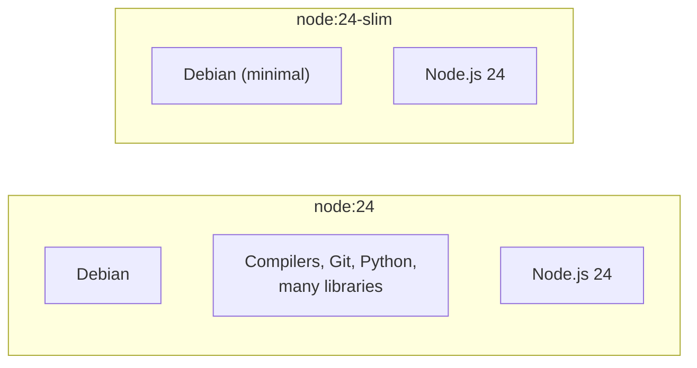

# Step 5: Smaller Base Image

[← Phase 3](README.md)

## Problem

The image is about 1.6 GB on disk for a server of a few hundred bytes. Almost all of it comes from the base image `node:24`, which includes compilers, Git, Python, and many libraries. They exist so npm packages with native code can be built inside the image. This server has no dependencies, so it needs none of them.

A large image is slow to push and pull (CI will do both on every change), and every extra program is one more place a vulnerability can hide.

## Change

One word in the `Dockerfile`:

```dockerfile
FROM node:24-slim
```

`node:24-slim` is the same Debian family and the same Node.js 24, with the build tools removed.



### Other options considered

| Base | Size | Why not chosen |
|---|---|---|
| `node:24-alpine` | Smaller | Different system library (musl); harmless here, but a new variable |
| Distroless | Smallest | No shell or tools at all; `docker compose exec` debugging stops working |

## The analogy

The food truck was built on a chassis that came with a full workshop in the back: lathes, welding gear, spare parts. Useful for building things, useless for serving food. The slim chassis carries only the kitchen. The truck is lighter, faster to deliver, and has fewer things that can break or be broken into.

## Before and after

| | Before (`node:24`) | After (`node:24-slim`) |
|---|---|---|
| Disk usage | 1.63 GB | 330 MB |
| Download size (content size) | 410 MB | 81 MB |
| Node.js | 24 | 24 |
| `ps` inside the container | Available | `executable file not found` |

About **80% smaller**. *Disk usage* is the unpacked size on the host; *content size* is the compressed size transferred from a registry.

## Trade-off

Fewer tools inside the container. Commands like `docker compose exec app ps` stop working. That's normal for production images: a running container shouldn't need debugging tools, and having none means an attacker inside has none either.

## Verify

```bash
docker compose up -d --build
docker image ls devops-lab-app      # ≈ 330 MB
curl -i http://localhost:8080       # 200 Hello world
docker compose exec app node -v     # v24.x
docker compose down
```