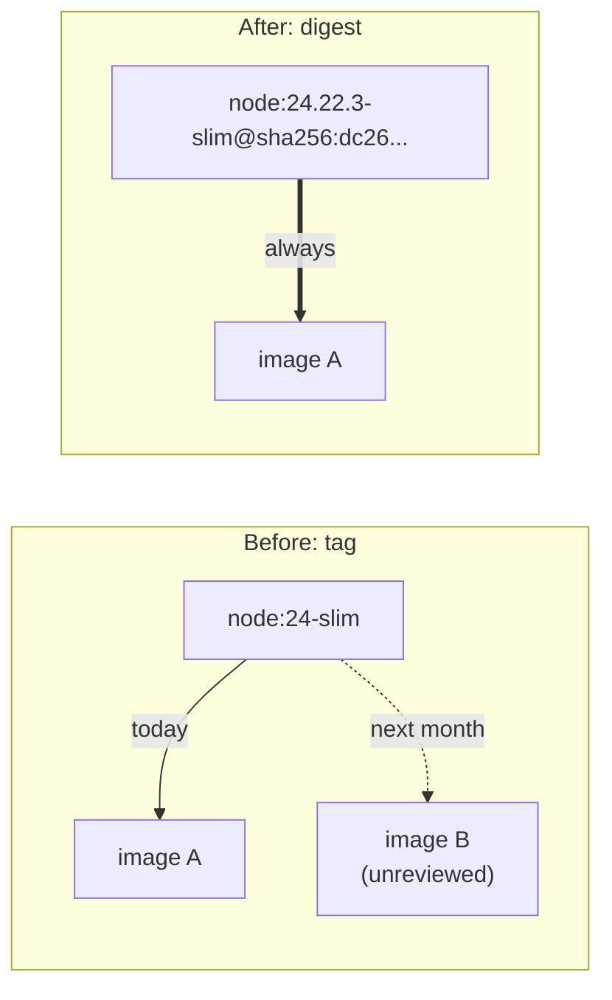

# Step 6: Pin the Base Image by Digest

[← Phase 3](README.md)

## Problem

`node:24-slim` is a **tag**: a movable label. The Node.js image maintainers rebuild it regularly, for new Node.js versions and Debian security patches. Building next month could silently produce a different image, without anyone reviewing what changed.

## Change

```dockerfile
FROM node:24.22.3-slim@sha256:dc26ae92c9fb15cf6b1d63e20f0944b2efe0f115b20e00be48fb23fceb061c54
```

| Part | Meaning |
|---|---|
| `node:24.22.3-slim` | The tag, now with the **exact Node.js version**. Only for humans: Docker ignores it when a digest is present |
| `@sha256:dc26...` | The **digest**: a hash of the image's exact content. This is what Docker actually uses |



## Choosing the version and digest

| Check | Result |
|---|---|
| `docker run --rm node:24-slim node -v` | `v24.22.3`: the tag moved from 24.22.2 to 24.22.3 during this work |
| `docker pull node:24.22.3-slim` | Digest `sha256:dc26ae92...`, the same image as `node:24-slim` |
| Node.js release notes, v24.22.3 (2026-11-11) | "This is a security release." |
| `docker pull node:24.22.2-slim` | Digest `sha256:01d566e8...`: the previous version, not chosen |

### The cooldown rule, and its exception

- **New software versions** wait 14 days: compromised releases are usually discovered within days.
- **Rebuilds of an accepted version** (operating system patches only) are adopted directly.
- **Security releases are adopted directly, and documented.** The cooldown protects against *unknown* problems; a security release fixes *known* vulnerabilities, so waiting would leave them open.

**Decision:** Node.js 24.22.3, released 2 days ago, adopted as a security release.

## The analogy

Ordering "the current model of the slim chassis" from the factory means whatever the factory builds that week. Ordering by **serial number** means exactly one specific chassis, the one already inspected. The model name is still written on the order, so people know what it is, but the factory only looks at the serial number.

## Before and after

| | Before | After |
|---|---|---|
| `FROM` | `node:24-slim` | `node:24.22.3-slim@sha256:dc26...` |
| Rebuild next month | May produce different content | Identical content |
| Node.js version visible in the file | Only the major version (24) | Exact (24.22.3) |
| Security patches | Arrive silently with any rebuild | Only when the digest is updated on purpose |

## Trade-off

Updates are now **manual**. New patches don't arrive until someone looks up a new digest, updates the `FROM` line, and tests. That's the point (nothing changes unreviewed), but it creates a duty. Tools like Dependabot or Renovate automate it by opening a pull request with the new digest; out of scope for now. Procedure: [cheat sheet, "Updating the base image"](../../cheatsheets/docker.md#updating-the-base-image).

## Verify

```bash
docker compose up -d --build        # first build step shows node:24.22.3-slim@sha256:dc26...
curl -i http://localhost:8080       # 200 Hello world
docker compose exec app node -v     # v24.22.3
docker compose down
```
