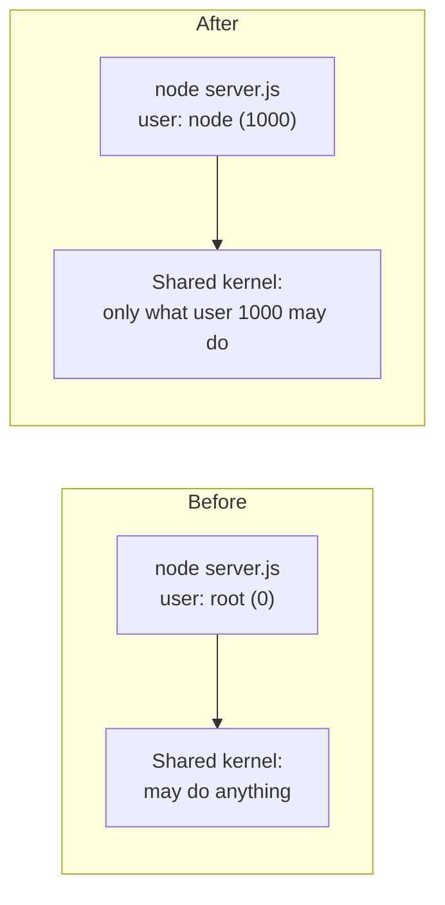

# Step 7: Run as a Non-Root User

[← Phase 3](README.md)

## Problem

The image never names a user, so the server runs as **root**. Containers share the host's kernel: root inside the container is root on the kernel. An attacker who could run code through the server *and* escape the container would start as root on the host.

## Change

```dockerfile
USER node
```

The official Node.js images include an unprivileged user, `node` (user ID 1000). Everything after `USER` in the `Dockerfile`, including the container's command, runs as that user.

Nothing else is needed:

- `server.js` is readable by everyone; the server only reads it.
- Only ports **below 1024** require root. The app uses 3000.



## The analogy

Until now, the cook in the food truck held the **master key** to the whole truck park. Now the cook gets a key to **their own kitchen only**. Cooking works exactly the same; but if the cook were tricked into opening doors, only one kitchen is exposed.

## Before and after

| | Before | After |
|---|---|---|
| `docker compose exec app whoami` | `root` | `node` |
| User ID inside | 0 | 1000 |
| Shown on the host (`ps -eo user,comm,args \| grep "[s]erver.js"`) | `root` | The host user with ID 1000 (`node server.js` and `docker-init`) |
| `curl -i localhost:8080` | 200 Hello world | 200 Hello world |

## Nuance: user IDs are shared

The kernel identifies users by **number**, not name. The host user is usually also ID 1000, so the host displays the container's process under that user's name. An escaped attacker would hold that user's rights: far less than root, but not nothing. Stricter setups use a high, unused ID (for example 10001) that matches no host user. Possible later refinement.

## Verify

```bash
docker compose up -d --build
docker compose exec app whoami      # node
docker compose exec app id          # uid=1000(node) gid=1000(node)
curl -i http://localhost:8080       # 200 Hello world
docker compose down
```