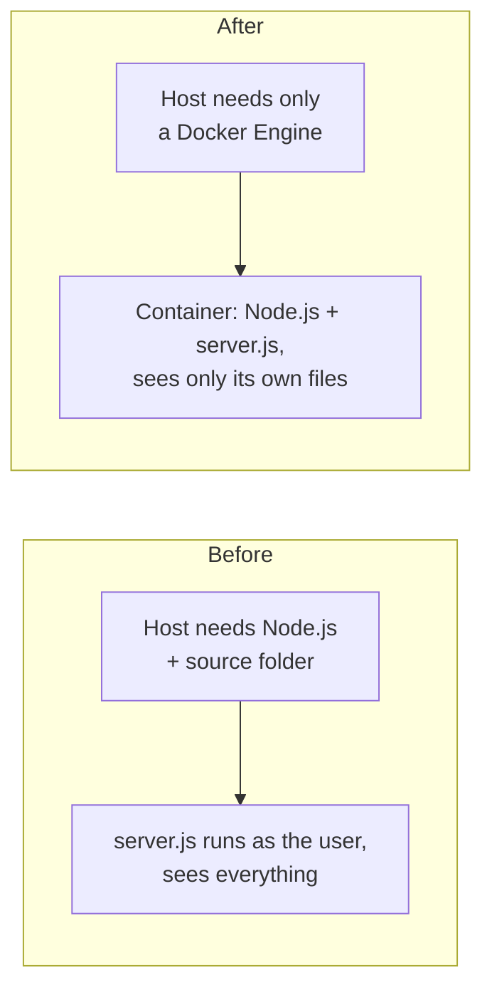
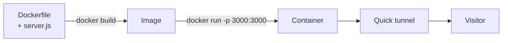
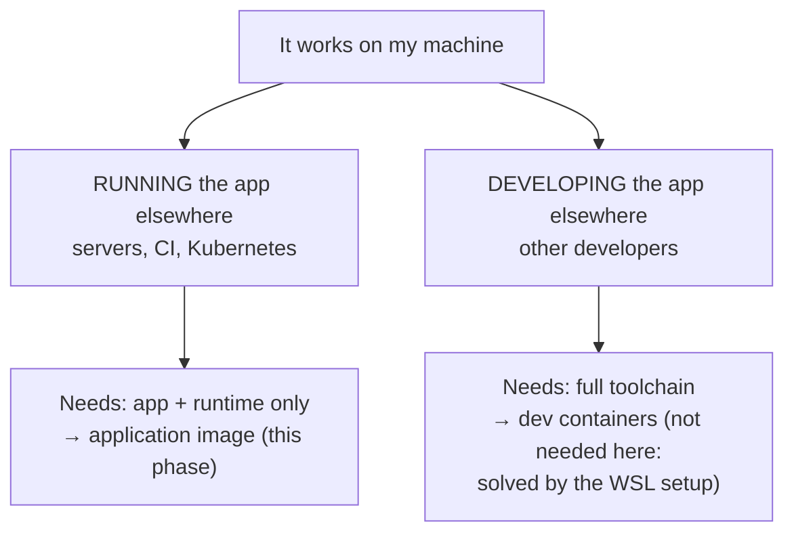

# Phase 3: Container

## Problem

1. The app only runs on a machine prepared by hand: Node.js installed, the source folder present.
2. The server runs with the laptop user's full permissions: a bug could reach SSH keys and Windows files.

This is the classic **"it works on my machine"** problem.

## Solution

Package the app **together with the exact runtime it needs** into an **image**, and run it as a **container**: an isolated process that sees only the image's files.





## The idea, as an analogy

So far, the dish could only be cooked in one kitchen that was set up by hand. To serve customers anywhere, the restaurant builds **food trucks**.

- A **construction plan** says exactly how to build a truck: which stove, which ingredients, which dish.
- The **workshop** follows the plan and produces a **sealed truck model**, identical every time.
- The model can be copied any number of times. Each **copy, open for business**, serves customers. Closing a copy doesn't change the model.
- Finished models are kept in a **depot**, from which any city can fetch them.
- A city's **truck service** builds, stores, and opens the trucks. Whoever controls the truck service controls every truck.

| Kitchen | Docker |
|---|---|
| Construction plan | `Dockerfile` |
| Building a truck in the workshop | `docker build` |
| Sealed truck model | Image |
| The model's serial number | Image digest (`sha256:...`) |
| A copy, open for business | Container |
| Opening a copy | `docker run` |
| Depot | Registry (Docker Hub, GHCR) |
| City's truck service | Docker Engine |

## "Works on my machine" is two problems



This phase solves the first one. Everything after it (CI, registries, Kubernetes, Argo CD) moves and runs application images.

## Why Docker

The industry standard for packaging applications. Its image format is an open standard (OCI), and every later tool in this pipeline works with images. Nothing after this phase is possible without them.

## What we tested

| Experiment | Result | Lesson |
|---|---|---|
| `docker run node:24 node -v` | v24.22.2 (host has v24.22.1) | The container brings its own runtime; `node:24` is a **movable tag** |
| Shell in `ubuntu:26.04`: `ls /home`, `ls /mnt` | No user home, no Windows drive | A container sees only its image's files |
| `uname -r` inside and outside | Same kernel | A container is **not a virtual machine**: one shared kernel |
| `ps aux` on the host | The container's shell is visible, as **root** | A container is a normal, restricted process; root inside is root on the kernel |
| Mount a folder, create a file | File appears on the host, owned by root | Access to host files only through explicit mounts |
| `docker run` without `-p`, then `curl` | Connection refused | A container has **its own network** |
| `docker run -p 3000:3000`, then `curl` | `200 Hello world` | Publishing a port connects host and container |
| Ctrl+C on the running container | Nothing happens | The server is **process 1**; unhandled stop signals are ignored |
| `time docker stop` | ~10 seconds | Docker asks politely, waits 10 s, then kills |
| `docker exec ... whoami` | `root` | The image never names a user |

## Cost and trade-offs

| Gain | Cost |
|---|---|
| Runs the same wherever a Docker Engine exists | A new root-level background service |
| The app can't see the host's files, keys, or processes | Using Docker without `sudo` means root-equivalent rights (`docker` group) |
| One self-contained artifact with a unique ID | The naive image is ~1 GB |
| | New concepts: images, containers, registries, ports, signals |
| | Weaker isolation than a virtual machine: one shared kernel |

## The naive image, and what's wrong with it

```dockerfile
FROM node:24
COPY server.js .
CMD ["node", "server.js"]
```

Deliberately the simplest that works. Its problems were observed, not assumed:

| Problem | Consequence |
|---|---|
| ~1 GB for a few hundred bytes of code | Slow to move; large attack surface |
| Runs as root | A server bug is a root process on the shared kernel |
| Ignores stop signals | Every stop waits 10 s, then a forced kill |
| App copied into `/` | Mixed in with operating system files |
| Movable base tag `node:24` | A rebuild can silently produce a different image |

## Limitations

- The image is built by hand and exists only on the laptop → **Phase 4 (CI)**.
- The naive image's problems above.
- Everything from phase 2 still applies to the tunnel.

How Docker works in detail: [explanation/docker.md](../../explanation/docker.md). Commands: [reference/docker-commands.md](../../reference/docker-commands.md).
