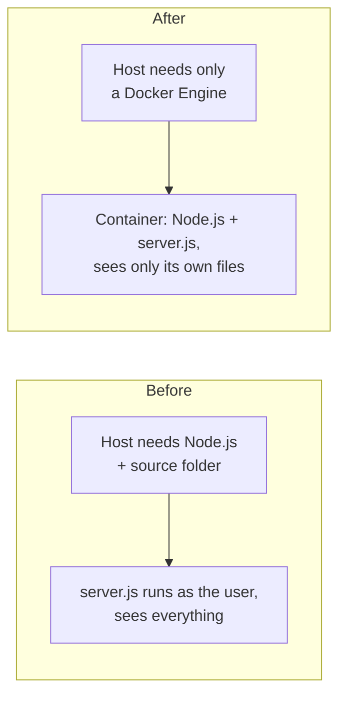
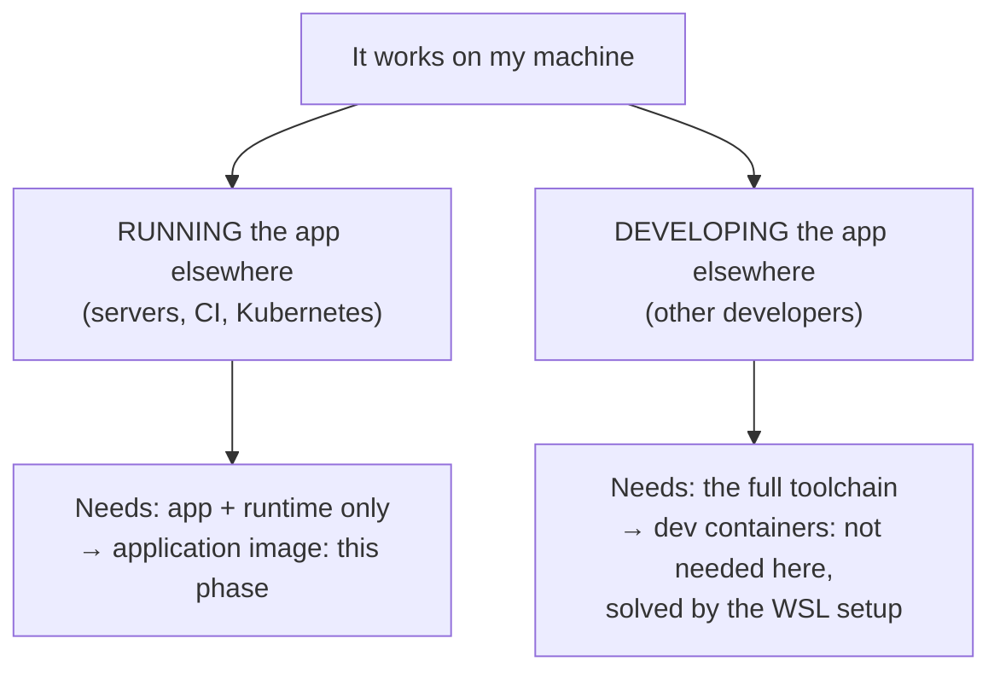

# Phase 3: Container

**Status:** in progress

## The problems this phase solves

1. **The app only runs on a machine prepared by hand:** Node.js must be installed, and it runs from the source folder.
2. **The server runs with the laptop user's full permissions:** a bug in it could reach SSH keys, the repository, and Windows files.

Both are versions of the classic **"it works on my machine"** problem.

## The tool: Docker

Docker packages an application **together with the exact runtime it needs** into an **image**, and runs that image as a **container**: an isolated process that sees only the image's files.

**Why Docker:** it's the industry standard for packaging applications, its image format is an open standard (OCI), and every later tool in this pipeline (CI, registries, Kubernetes, Argo CD) works with images. Nothing after this phase is possible without them.

**Docker Compose** is part of the same toolset: a plugin that reads the container settings from a file instead of from long commands.

### "Works on my machine" is two problems

## The analogy: food trucks

So far, the dish could only be cooked in one kitchen that was set up by hand. To serve customers anywhere, the restaurant builds **food trucks**.

- A **construction plan** says exactly how to build a truck: which stove, which ingredients, which dish.
- The **workshop** follows the plan and produces a **sealed truck model**, identical every time.
- The model can be copied any number of times. Each **copy, open for business**, serves customers. Closing a copy doesn't change the model.
- Finished models are kept in a **depot**, from which any city can fetch them.
- For an event, an organizer works from a **site plan**: one sheet listing which trucks come, where they park, and which serving window faces the street. One call to the organizer sets up the whole site.
- On the site, trucks talk to each other **by name** over a private service road. Only the windows listed on the plan face the public street.

| Kitchen | Docker |
|---|---|
| Construction plan | `Dockerfile` |
| Building a truck in the workshop | `docker build` |
| Sealed truck model | Image |
| The model's serial number | Image digest (`sha256:...`) |
| A copy, open for business | Container |
| Depot | Registry (Docker Hub, GHCR) |
| Site plan | `compose.yaml` |
| Calling the organizer | `docker compose up` |
| Private service road; trucks addressed by name | Project network; services addressed by name |
| Window facing the street | Published port (`8080:3000`) |

## Trade-offs

| Gain | Cost |
|---|---|
| Runs the same wherever a Docker Engine exists | A new root-level background service |
| The app can't see the host's files, keys, or processes | Using Docker without `sudo` means root-equivalent rights (`docker` group) |
| One self-contained artifact with a unique ID | The naive image is ~1 GB |
| Configuration lives in a file, reviewed like code | New concepts: images, containers, registries, ports, networks, signals |
| | Weaker isolation than a virtual machine: one shared kernel |

## Steps

Each step is one small change that solves one problem.

| Step | Problem | Change |
|---|---|---|
| [1. Naive image](1-naive-image.md) | App needs Node.js on the host | A three-line `Dockerfile` |
| [2. Compose](2-compose.md) | Run settings live in long commands | `compose.yaml` |
| [3. Init process](3-init.md) | Every stop waits 10 s, then kills | `init: true` |
| [4. Tunnel in a container](4-tunnel-container.md) | Second terminal; cloudflared runs as the user | `tunnel` service in `compose.yaml` |
| [5. Smaller base image](5-slim-base-image.md) | ~1.6 GB image | `FROM node:24-slim` |
| [6. Pin the base image by digest](6-pin-base-image.md) | A rebuild can silently change the image | `FROM node:24.22.3-slim@sha256:...` |
| 7. Non-root user | The app runs as root | Planned |

## Result

What's fixed, what's open, and what's new: [result.md](result.md).

Deeper reading: [how Docker works](../../explanation/docker.md) · [Docker cheat sheet](../../cheatsheets/docker.md)
