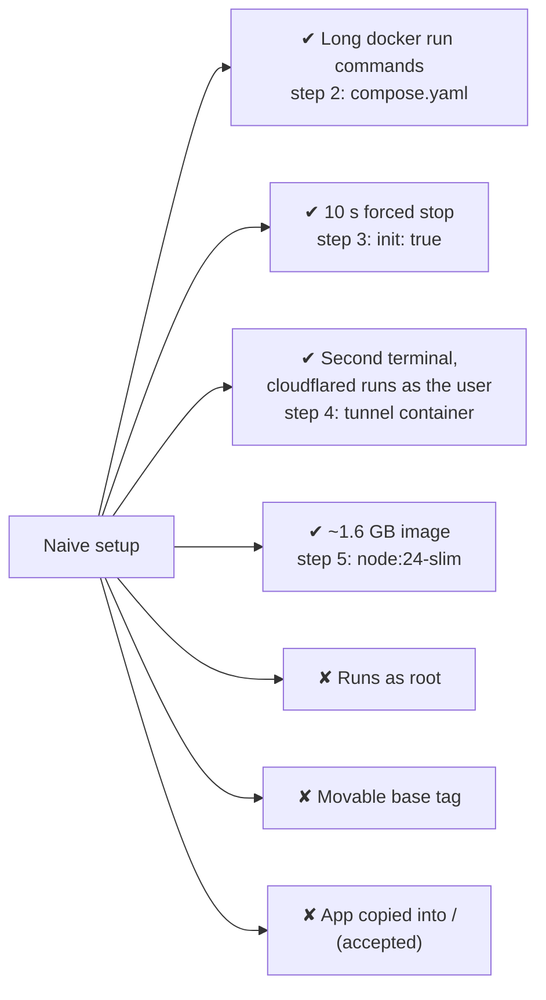

# Phase 3: Result

[← Phase 3](README.md)

## Progress

Every problem found in the naive setup, and what happened to it.

| Problem | Status | Fixed by |
|---|---|---|
| App needs Node.js on the host | ✔ Fixed | Step 1: image |
| Server can see the user's files and keys | ✔ Fixed | Step 1: container isolation |
| Settings live in long commands | ✔ Fixed | Step 2: `compose.yaml` |
| Every stop waits 10 s, then kills | ✔ Fixed | Step 3: `init: true` |
| Tunnel needs a second terminal and runs as the user | ✔ Fixed | Step 4: `tunnel` service, non-root, pinned by digest |
| ~1.6 GB image | ✔ Fixed | Step 5: `node:24-slim`, 330 MB |
| Runs as root | ✘ Open | Planned: step 7 |
| Movable base tag | ✘ Open | Planned: step 6 |
| App copied into `/` | ✘ Accepted | Cosmetic; no security or size impact |

## New limitations introduced by this phase

| Limitation | Why it matters |
|---|---|
| Docker Engine runs as root; the `docker` group is root-equivalent | Anyone in the group controls the whole distro |
| Containers share the host's kernel | Weaker isolation than a virtual machine |
| Compose runs on one machine only | No spreading load, no moving containers between machines |
| The public URL appears only in the tunnel's logs | Looked up with `docker compose logs tunnel` after every start. Accepted: a stable address removes it |
| No debugging tools inside the app container | `ps` and similar are missing since step 5. Intended for production images |

## Limitations carried into the next phase

- The image is built by hand and exists only on this laptop → **Phase 4: CI**.
- A crashed container stays down → **Phase 5: Kubernetes**.
