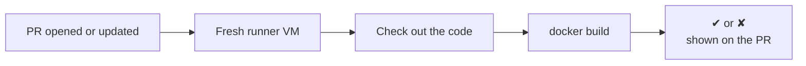

# Step 1: Build the Image on Every PR

[← Phase 4](README.md)

## Problem

- The image is only ever built by hand, on one laptop.
- A change that breaks the build (a typo in the `Dockerfile`, a missing file) can be merged without anyone noticing.

## Change

`.github/workflows/ci.yml`:

```yaml
name: CI

on:
  pull_request:

permissions:
  contents: read

jobs:
  build:
    runs-on: ubuntu-24.04
    steps:
      - name: Check out the repository
        uses: actions/checkout@3d3c42e5aac5ba805825da76410c181273ba90b1 # v7.0.1

      - name: Build the image
        run: docker build -t devops-lab:ci .
```

| Part | Meaning |
|---|---|
| `on: pull_request` | Run whenever a pull request is opened or updated |
| `permissions: contents: read` | The automatic token can only read the repository (least privilege) |
| `runs-on: ubuntu-24.04` | A fresh Ubuntu 24.04 VM from GitHub, deleted after the run |
| `actions/checkout@<SHA>` | Official action that copies the repository onto the runner, pinned by commit SHA |
| `docker build -t devops-lab:ci .` | Build the image from the `Dockerfile`; `-t` names it (`ci` = built by CI) |

## How it works



- **A fresh machine every time:** nothing from a laptop is on the runner. If it builds there, it builds anywhere.
- **The image is thrown away:** this step only proves the build works. Publishing comes in step 3.

## The analogy

Every proposed change to the truck's construction plan now goes to an **inspection station**: an empty hall where the truck is built from scratch, with nothing borrowed from anyone's garage. If the truck can't be built, the proposal is marked as failed.

## Security choices

- **Actions pinned by commit SHA:** an action is third-party code. A tag like `v7` can be moved to different code; a commit SHA can't.
- **Read-only token:** building needs no write access.
- **Runner OS pinned by label:** `ubuntu-24.04` instead of `ubuntu-latest`, which moves without notice.

## Before and after

| | Before | After |
|---|---|---|
| Who builds the image | A developer, by hand | GitHub Actions, on every PR |
| Where | One laptop | A fresh VM each time |
| A broken build | Noticed when someone tries | Shown on the PR as ✘ |

## Limitations

- **Runner VMs can't be pinned:** GitHub updates them weekly; only the OS version is fixed. Accepted: the image's content comes from the pinned base image and the repository, not the runner.
- **Passing build ≠ working app:** the build can succeed while the server is broken → step 2.

## Verify

The **CI / build** check on a pull request shows ✔. **Details** shows each step's log.