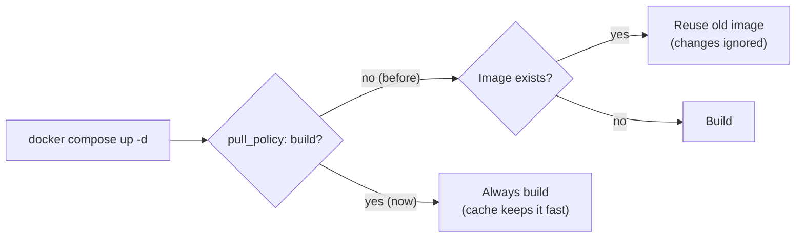

# Step 2: Always Rebuild the App Image

[← Phase 4](README.md)

## Problem

- `docker compose up` builds an image **only if none exists yet**.
- After the first build, plain `up` reuses the old image, even when `server.js` has changed.
- The fix was a flag, `--build`, that had to be remembered on every start. Forgetting it means testing old code without noticing.

## Change

In `compose.yaml`, for the `app` service:

```yaml
    build: .
    # Always build from source on "up", so the running app matches the code.
    pull_policy: build
```

- **`pull_policy`:** how Compose gets a service's image.
- **`build`:** always build it from source on `up`, even if an image already exists.

The rule now lives in configuration, not in a flag on a command.

## How it works



- **Build cache:** Docker reuses every unchanged build step, so rebuilding an unchanged project takes about a second.

## The analogy

The organizer used to send out the truck already parked in the lot, even after the construction plan had changed, unless someone explicitly said "build a new one." Now the site plan says: **always build from the current plan**. Unchanged parts come straight from the workshop shelf, so it stays quick.

## Before and after

| | Before | After |
|---|---|---|
| Start with current code | `docker compose up -d --build` | `docker compose up -d` |
| Forgetting the flag | Old code runs silently | Not possible |
| Where the rule lives | In someone's memory | In `compose.yaml` |
| Extra time per start | None | About a second (cache) |

## Verify

```bash
docker compose up -d            # build output appears, even with an existing image
curl http://localhost:8080      # Hello world
docker compose down
```

After changing `server.js`, a plain `docker compose up -d` serves the new code.