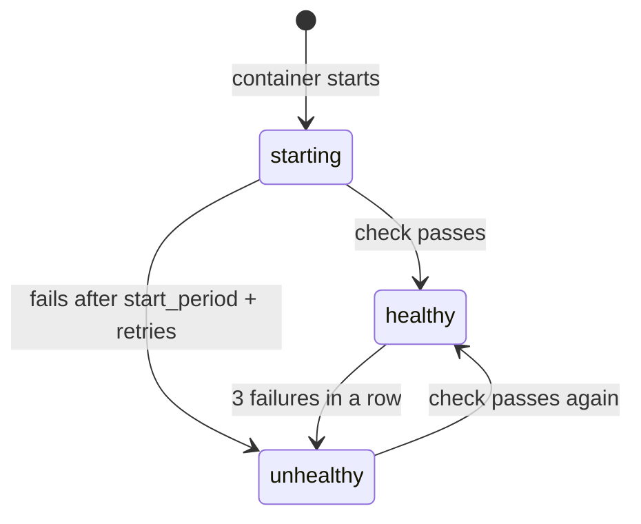

# Step 3: Add a Health Check

[← Phase 4](README.md)

## Problem

- **"Running" isn't "ready":** a container counts as running the moment its process starts, even if the server isn't answering yet, or has hung.
- **Nobody can tell the difference:** not Docker, not a developer, not CI.
- **CI would have to guess:** wait a fixed time, or retry in a loop inside the tests.

## Change

`compose.yaml`, `app` service:

```yaml
    healthcheck:
      # exit 0 = healthy; the slim image has no curl, so Node's built-in fetch checks the app
      test: ["CMD", "node", "-e", "fetch('http://localhost:3000').then(r => process.exit(r.ok ? 0 : 1), () => process.exit(1))"]
      interval: 10s     # check every 10 s
      timeout: 3s       # a slower check counts as failed
      retries: 3        # unhealthy after 3 failures in a row
      start_period: 5s  # failures in the first 5 s don't count
```

`.github/workflows/ci.yml`:

```yaml
jobs:
  build-and-test:
    runs-on: ubuntu-24.04
    timeout-minutes: 10  # stop the job if anything hangs
    steps:
      - name: Check out the repository
        uses: actions/checkout@<SHA>  # v7.0.1

      - name: Build and start the app, wait until healthy
        run: docker compose up --wait app  # the app only, never the tunnel

      - name: Show the app's logs if a step failed
        if: failure()
        run: docker compose logs app
```

- **Health check:** Docker runs a command inside the container every 10 s; exit 0 = healthy.
- **`--wait`:** `up` returns only once the app is healthy, and fails if it turns unhealthy. Implies `-d`.
- **`app`:** starts only the app; the tunnel never runs in CI.
- **`timeout-minutes: 10`:** caps the whole job (default: 6 hours).
- **Logs on failure:** a failed start shows *why*, not just "unhealthy."
- **Job renamed** to `build-and-test`: the check is now **CI / build-and-test**.

## How it works



## Health check vs smoke test

| | Health check | Smoke test (next step) |
|---|---|---|
| Question | Is the app alive and ready? | Does it behave correctly? |
| Who asks | The platform (Docker, later Kubernetes) | The pipeline (CI) |
| How often | Continuously | Once per build |
| Checks | It responds at all | Status, headers, body |

## Why it's in the CI phase

- **CI needs it now:** to know when the app is ready before testing it.
- **It's also a runtime feature:** Kubernetes uses the same idea, as *liveness* and *readiness probes*, in Phase 5.

## The analogy

A truck being **open** isn't the same as **ready to serve**: the grill may still be heating. An attendant now **knocks on the serving window every 10 seconds** and notes whether someone answers. The inspection station waits for "ready" before ordering its test dish, instead of guessing.

## Before and after

| | Before | After |
|---|---|---|
| `docker compose ps` | `Up` | `Up (healthy)` |
| Hung server | Still shown as `Up` | `unhealthy` |
| CI start | Starts and moves on | Waits until healthy; fails if unhealthy |
| A stuck job | Runs up to 6 hours | Stopped after 10 minutes |

## Verify

```bash
docker compose up --wait
docker compose ps --format "table {{.Service}}\t{{.Status}}"   # app: Up ... (healthy)
docker compose down
```

On a PR: **CI / build-and-test** passes.