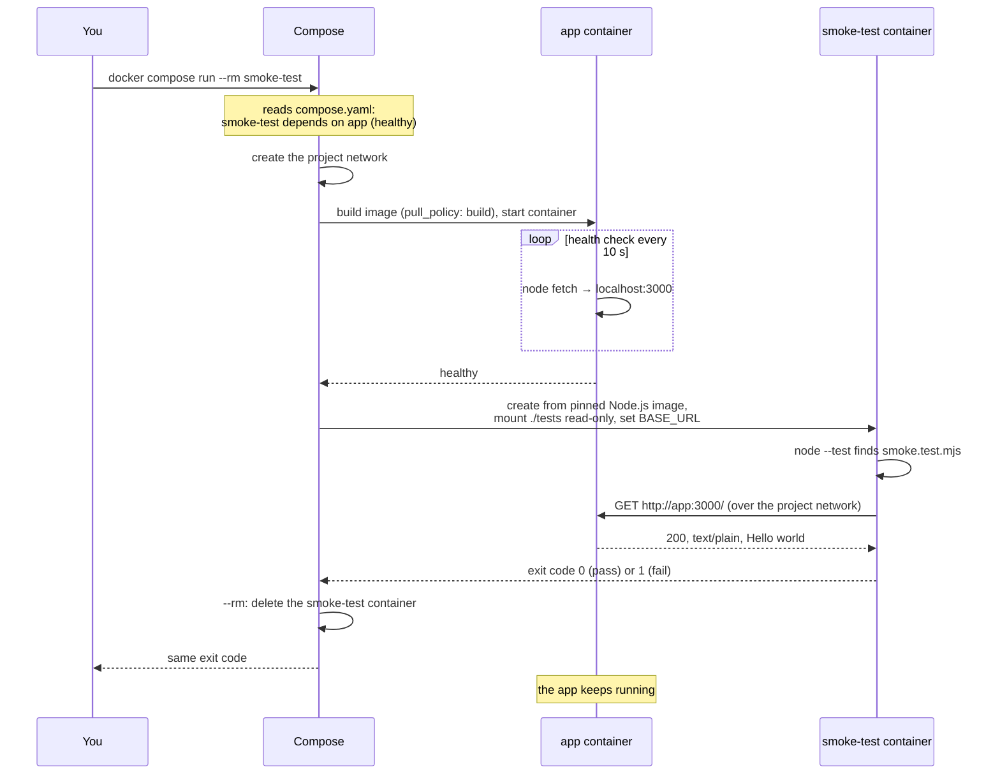

# Step 4: Smoke-Test the App on Every PR

[← Phase 4](README.md)

## Problem

- The health check proves the app **answers**, not that it answers **correctly**.
- A change that returns the wrong text, status, or content type passes every check so far.

## Change

- **`tests/smoke.test.mjs`:** a test written with Node.js's built-in test runner (`node --test`). It checks that `GET /` returns `200`, `text/plain`, and `Hello world`.
- **`compose.yaml`:** a one-off `smoke-test` service that runs the test in a container, from a pinned Node.js image.
- **`ci.yml`:** a step that runs it, after the app is healthy.

```js
test("GET / returns 200, plain text, Hello world", async () => {
  const response = await fetch(`${BASE_URL}/`);

  assert.equal(response.status, 200);
  assert.equal(response.headers.get("content-type"), "text/plain; charset=utf-8");
  assert.equal(await response.text(), "Hello world\n");
});
```

## Why `node --test`

| Option | Chosen? | Why |
|---|---|---|
| **`node --test`** | ✔ | Built into Node.js: no packages. Reads like Jasmine/Jest. Grows into real API and unit tests |
| Bash + curl | ✘ | Hard to read and to extend |
| Jest / Vitest | Later | Industry standard, but brings npm, `package.json`, a lockfile: too much for one test |
| Hurl | ✘ | Very readable, but HTTP checks only; no logic |
| k6 | Later | Built for load testing; a candidate for a later step |

## Why in a container

- **Nothing installed** on the laptop or the CI runner: the test runs in the pinned Node.js image.
- **One command, everywhere:** `docker compose run --rm smoke-test`, locally and in CI.
- **Reaches the app like a neighbor:** inside the project network, at `http://app:3000`.

## How it works



- **Dependencies first:** `depends_on` with `condition: service_healthy` makes Compose start the app and wait for its health check before the test container starts. The test needs no retry logic.
- **Exit code:** 0 = all tests passed, 1 = a test failed. Compose passes it on; CI turns it into ✔ or ✘.
- **The app keeps running** after the test: stop it with `docker compose down`.
- **The tunnel never starts:** nothing depends on it.
- **The profile `test`:** keeps `docker compose up` from running the tests on every start. `run smoke-test` names the service, which activates its profile automatically: no flag needed.

## Two CI steps, not one

`docker compose run --rm smoke-test` would also start the app on its own, through `depends_on`. CI still starts the app in a separate step first:

```yaml
      - name: Build and start the app, wait until healthy
        run: docker compose up --wait app

      - name: Run the smoke test
        run: docker compose run --rm smoke-test
```

The point is **which step turns red** when something breaks:

| Failure | One step (`run` only) | Two steps (ours) |
|---|---|---|
| App never becomes healthy | ✘ Run the smoke test (misleading: no test ran) | ✘ Build and start the app, wait until healthy |
| App answers wrongly | ✘ Run the smoke test | ✘ Run the smoke test |

The failing step's name says whether it's a **startup** problem or a **behavior** problem, before opening any log.

## Health check vs smoke test

| | Health check (step 3) | Smoke test (this step) |
|---|---|---|
| Question | Is the app alive and ready? | Does it behave correctly? |
| Who asks | The platform | The pipeline |
| How often | Continuously | Once per build |
| Checks | It responds | Status, content type, body |

## The analogy

The attendant knocking on the serving window (the health check) only learns that **someone answers**. Now the inspection station **orders a dish and checks the plate**: the right dish, served the right way. The station brings its own tester in a separate truck, parks on the same site, and orders through the service road, so nothing has to be installed in the inspection hall.

## Before and after

| | Before | After |
|---|---|---|
| App answers wrongly | ✔ (missed) | ✘ Run the smoke test |
| Testing locally | By hand, with `curl` | `docker compose run --rm smoke-test` |
| Tools to install | — | None (test runs in a container) |

## Limitations

- **Values repeat across files:** port `3000` and the app's address appear in `server.js`, `compose.yaml`, and the test's `BASE_URL`. They don't differ between environments, so this is duplication, not configuration. One source of values arrives with Helm (Phase 6).
- **The Node.js image digest is pinned in two places:** the `Dockerfile` and the `smoke-test` service. An update must change both.
- **The tunnel isn't tested in CI:** it needs Cloudflare and the internet.
- **The image is still thrown away after CI:** nothing is published → step 5.

## Verify

```bash
docker compose run --rm smoke-test   # ✔ GET / returns 200, plain text, Hello world
echo $?                              # 0
docker compose down
```

On a PR: **CI / build-and-test** passes; **Details → Run the smoke test** shows the same ✔ line.
