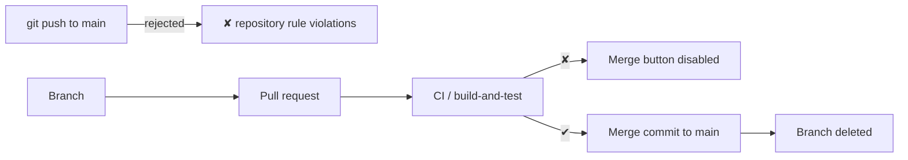

# Step 5: Protect `main`

[← Phase 4](README.md)

## Problem

- **CI only reports; it doesn't stop anything:** a PR with a failing check can still be merged.
- **`main` accepts direct pushes:** changes can skip pull requests and CI entirely.
- **`main` can be rewritten or deleted:** a force push can erase history.

## Change

A GitHub **ruleset** on `main`, with no bypass, plus pull request and security settings. All values and reasons: [Repository settings](../../how-to/repository-settings.md).

- **Pull request required:** no direct pushes.
- **`build-and-test` must pass,** against an up-to-date branch.
- **No force pushes, no deletion.**
- **Merge commits only.**
- **Merged branches deleted automatically.**
- **Push protection:** pushes containing secrets are blocked.

## How it works



## Rulesets vs branch protection

| | Rulesets | Classic branch protection |
|---|---|---|
| Status | Newer, recommended | Older |
| Named, can target several branches | Yes | One rule per branch pattern |
| Shows what's enforced | Clearly, per ruleset | Less clearly |

## The analogy

Until now, the inspection station wrote its verdict on every proposal, but anyone could still walk past it and add pages to the official plan book, or tear pages out. Now the plan book sits **behind a gate**: only proposals with a passed inspection get in, through one entrance, and nobody, not even the owner, can tear out pages.

## Before and after

| | Before | After |
|---|---|---|
| PR with failing CI | Can be merged | Merge button disabled |
| Direct push to `main` | Accepted | Rejected |
| Force push or deletion of `main` | Possible | Blocked |
| Merged branches | Stay until deleted by hand | Deleted automatically |
| Pushing a secret | Becomes public | Blocked before it lands |

## Limitations

- **No second reviewer:** approvals are set to 0. With a single owner, CI is the only gate.
- **Settings aren't code:** they live in GitHub, recorded only in [Repository settings](../../how-to/repository-settings.md).
- **The required check is tied to a name:** renaming the CI job blocks every PR until the ruleset is updated.

## Verify

A direct push to `main` is rejected:

```bash
git commit --allow-empty -m "Test: main rejects direct pushes"
git push                       # ✘ repository rule violations
git reset --hard origin/main
```