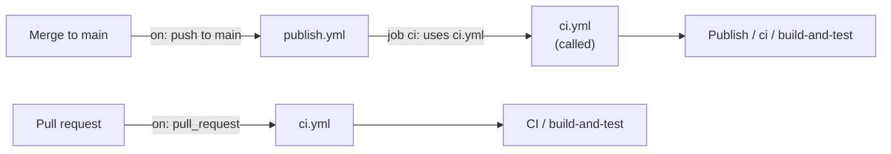

# Step 6: Test Every Merge to `main`

[← Phase 4](README.md)

## Problem

- **A PR is tested on its branch, not on the merge result:** the merge creates a new commit on `main` that no check has seen.
- **Step 8 publishes what's on `main`:** the release workflow must test that exact commit first.
- **Copying the test steps into a second workflow** would let the two drift apart.

## Change

`ci.yml` becomes callable:

```yaml
on:
  pull_request:    # every pull request: opened or updated
  workflow_call:   # other workflows can call this one
```

`publish.yml` (new) runs on every push to `main` and calls it:

```yaml
name: Publish

on:
  push:
    branches: [main]  # every merge to main

permissions:
  contents: read

jobs:
  ci:
    uses: ./.github/workflows/ci.yml  # build and test the merged code, same steps as on PRs
```

- **`workflow_call`:** marks `ci.yml` as reusable. It never starts the workflow on its own.
- **`on: push: branches: [main]`:** `main` accepts only merged PRs, so this means "every merge."
- **`uses: ./.github/workflows/ci.yml`:** runs the called workflow's jobs inside this run. `./` = this repository, at this commit.
- **`name: Publish`:** the workflow's purpose. It only tests for now.

## How it works



- **Pull requests:** only `ci.yml` runs. `publish.yml` never appears.
- **Merges:** `publish.yml` runs and calls `ci.yml`. In the UI, the job is **ci / build-and-test** (caller job / called job).
- **Permissions:** the caller sets the maximum; the called workflow can only reduce them.

## Reusable workflow vs copied steps

| | Copy the steps into `publish.yml` | Call `ci.yml` (chosen) |
|---|---|---|
| Test steps defined | Twice | Once |
| A change to the tests | Must be made in both files | Applies everywhere |
| Risk | The two copies drift apart | None |

## The analogy

The inspection station's checklist used to exist only at the proposal desk. Now the gate to the official plan book uses **the very same checklist**, not a photocopy: every page that enters the book is inspected again, exactly the way proposals are.

## Before and after

| | Before | After |
|---|---|---|
| Commit on `main` after a merge | Never tested | Tested by **Publish / ci / build-and-test** |
| Test steps | In `ci.yml` | Still only in `ci.yml`, reused |
| Workflows on a PR | CI | CI (unchanged) |

## Verify

- On a PR: only **CI / build-and-test** runs.
- After merging: **Actions → Publish**, a run for the merge commit with **ci / build-and-test** ✔.