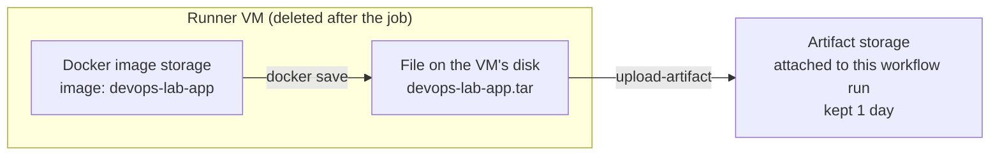
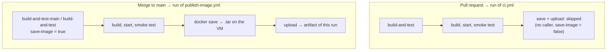

# Step 7: Keep the Tested Image as an Artifact

[← Phase 4](README.md)

## Problem

- **Jobs share nothing:** each job runs on its own fresh VM, deleted afterwards.
- **The tested image dies with its VM:** after `build-and-test`, the image that passed the smoke test is gone.
- **Publishing needs a separate job:** writing to a registry needs `packages: write`, and permissions are set per job. Giving that permission to `build-and-test` would give it to every pull request run.

## Change

`ci.yml` takes an input:

```yaml
  workflow_call:
    inputs:
      save-image:
        description: Save the tested image as an artifact of this run
        type: boolean
        default: false
```

Two new steps after the smoke test, run only when `save-image` is true:

```yaml
      - name: Save the tested image to a file
        if: inputs.save-image
        run: docker save --output devops-lab-app.tar devops-lab-app

      - name: Upload the tested image as an artifact
        if: inputs.save-image
        uses: actions/upload-artifact@cf430e030ddbb5b0abf93d22962f4752f3646cd9  # v7.0.2
        with:
          name: devops-lab-app-image
          path: devops-lab-app.tar
          retention-days: 1
          if-no-files-found: error
```

`publish.yml` is renamed to `publish-image.yml` ("Publish image"), and its job to `build-and-test-main`, which passes `save-image: true`.

## Where the image goes



- **`docker save`:** copies the image out of Docker's image storage into **one file**: all layers, the config, the name. Nothing runs.
- **Artifact:** a file a job uploads to GitHub's storage, **attached to its workflow run**. It survives the VM; other jobs in the same run, and people on the run's page, can download it.
- **`docker load`** on any machine turns the file back into the same image, with the same layers and ID.

## Pull request vs `main`



- **Pull requests:** the save and upload steps are skipped. Nothing is kept.
- **`main`:** the commit being released is built, tested, and its image kept as an artifact of that run.
- **Only after the smoke test:** a failed test stops the job, so an untested image is never saved.

## Why an artifact

| Option | Problem |
|---|---|
| Rebuild in a separate job | The published bytes would not be the tested bytes |
| Push from `build-and-test` | `build-and-test` runs on pull requests: they would get registry write access |
| **Artifact handoff (chosen)** | — exact tested bytes; write access can stay in a separate job |

## Security

- **Uploading an artifact needs no extra permission:** it uses a short-lived token scoped to the run, not `permissions:`.
- **Pull requests can change workflow files:** a PR could switch `save-image` on, or edit anything else. External PRs run only after the owner approves them (see [repository settings](../../how-to/repository-settings.md)), with a read-only token.

## Names

- **`publish-image.yml` / "Publish image":** what the workflow is for. ("Production" would be wrong: nothing is deployed.)
- **`build-and-test-main`:** what the job tests: the latest commit on `main`, the branch named in the same file's trigger.

## The analogy

See [analogy](../../explanation/analogy.md), Phase 4: the tasted truck is sealed in this session's locked garage, labelled with the file number, and scrapped after a day.

## Before and after

| | Before | After |
|---|---|---|
| Tested image after the job | Gone with the VM | On `main`: an artifact of the run |
| Pull request runs | Keep nothing | Keep nothing |
| Publish workflow | `publish.yml`, job `ci` | `publish-image.yml`, job `build-and-test-main` |

## Limitations

- **The artifact is kept for one day only,** and only inside GitHub's artifact storage: no machine can run the image from there.
- **The image is still not in a registry.**

## Verify

- Pull request: in **CI / build-and-test**, the save and upload steps are skipped; no Artifacts on the Summary page.
- After merging: **Actions → Publish image** run → Summary → **Artifacts: `devops-lab-app-image`**.