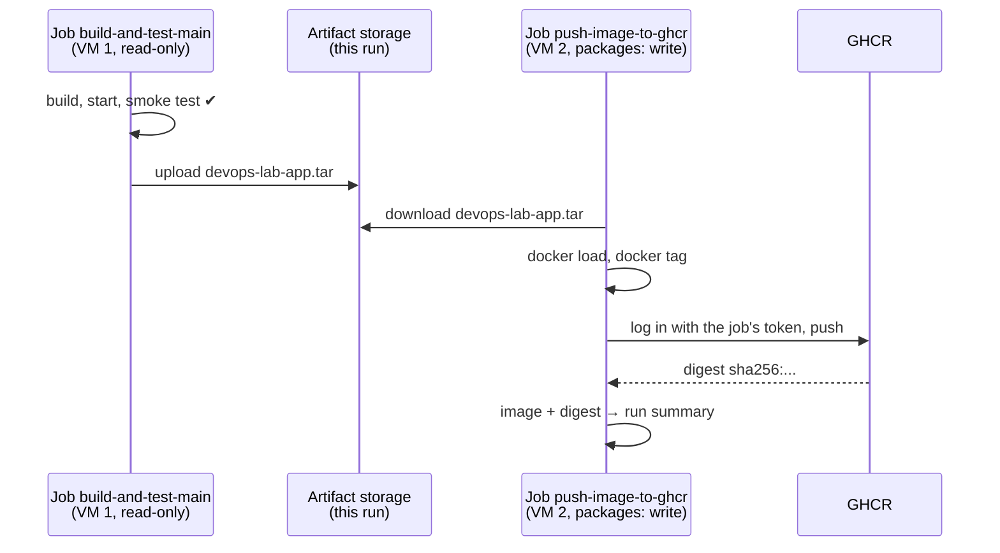

# Step 8: Publish the Tested Image to GHCR

[← Phase 4](README.md)

## Problem

- **The tested image exists only as an artifact:** kept one day, inside GitHub's artifact storage. No machine can run it from there.
- **No registry holds the image:** nothing can pull it.

## Change

A second job in `publish-image.yml`, `push-image-to-ghcr`, in four parts:

1. **Get the tested image onto the VM:** download the artifact, `docker load`.
2. **Name it for the registry:** `ghcr.io/<owner>/devops-lab:sha-<commit SHA>`, with `docker tag`.
3. **Publish it:** log in with the job's token, `docker push`.
4. **Show the result:** image name and digest on the run's Summary page.

```yaml
  push-image-to-ghcr:
    needs: build-and-test-main  # only after the tests on main pass
    permissions:
      packages: write  # push to GHCR; nothing else (no checkout needed)
```

## How it works



- **The published bytes are the tested bytes:** loaded from the artifact, never rebuilt.
- **One tag per commit:** `sha-<commit SHA>` links image and code both ways. No movable tags such as `latest`.
- **Lowercase:** registry names must be lowercase; `${GITHUB_REPOSITORY,,}` lowercases the owner.

## Security measures

- **Write access in one place:** `packages: write` exists only in this job. A job's `permissions:` replaces the workflow's default, so this job has nothing else, not even `contents: read`.
- **Only tested code, only from `main`:** `needs: build-and-test-main` plus the workflow's trigger.
- **No secrets stored:** the job's automatic `GITHUB_TOKEN` is created for the job and expires with it.
- **Secrets never become script text:** the token is passed through `env:` and read with `--password-stdin`. `${{ }}` is used only in `env:`, never inside `run:`, preventing *script injection*.
- **No login action:** the Docker CLI logs in, so there's one fewer third-party action.
- **The package is public:** the image contains no secrets.

## Decisions

| Decision | Why |
|---|---|
| Separate job for pushing | Permissions are per job; pull request runs never get write access |
| Tag `sha-<commit>`, no `latest` | Every tag means exactly one commit |
| Docker CLI login, not an action | One fewer dependency to trust and pin |
| Image and digest in the run summary | Visible without reading logs |
| Public package | Pullable without credentials; nothing secret inside |

## The analogy

See [analogy](../../explanation/analogy.md), Phase 4: the dispatch station, the only one with the depot key, takes the sealed truck from the session's garage to the central depot.

## Before and after

| | Before | After |
|---|---|---|
| Tested image | Artifact, kept one day | In GHCR, tagged with its commit |
| Who can run it | Nobody | Anyone: `docker pull ghcr.io/bende-kbb/devops-lab:sha-<commit>` |
| Digest | Not recorded | On the run's Summary page |

## Limitations

- **Nothing runs the published image:** the app is still started from a local build, by hand.
- **The package's settings live in the GitHub UI:** visibility and repository link aren't code.

## Verify

- **Actions → Publish image:** both jobs ✔; Summary shows image and digest.
- **Packages → `devops-lab`:** public, connected to the repository.
- `docker logout ghcr.io`, then `docker pull ghcr.io/bende-kbb/devops-lab:sha-<commit>` succeeds.