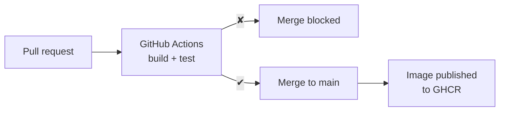

# Phase 4: Continuous Integration

**Status:** in progress

## The problems this phase solves

- **The image is built by hand:** nothing checks that a change still builds or still works. A broken change can be merged unnoticed.
- **The image exists only on the laptop:** nothing else can get it.
- **`main` accepts anything:** a failing change can still be merged.

## The tool: GitHub Actions

- **What it is:** GitHub's built-in automation. Workflow files in `.github/workflows/` say *when* to run (an event: a pull request, a push) and *what* to run.
- **Where it runs:** on a **runner**: a fresh virtual machine created for each run and deleted afterwards. Nothing from a developer's laptop is on it: if it builds there, it builds anywhere.
- **Why this tool:** it's built into GitHub, free for public repositories, and widely used. Its results appear directly on pull requests.
- **The registry: GHCR** (GitHub Container Registry, `ghcr.io`), where published images are stored, next to the code that produced them.

## The analogy: the inspection station

- **Before:** every new construction plan for the food truck went straight into the official plan book, untested. Trucks were built in the owner's own garage.
- **Now:** every proposed change to the plan goes to an **independent inspection station**. It builds the truck from scratch in an empty hall, with nothing borrowed from anyone's garage, and test-drives it.
- **Failed inspection:** the change is sent back. A **gate** keeps it out of the official plan book.
- **Passed inspection:** the change enters the plan book, and the inspected truck model is placed in the **public depot**, ready for any city to fetch.

| Inspection station | GitHub Actions |
|---|---|
| A proposed change to the plan | Pull request |
| Independent inspection station | Workflow |
| Empty hall, nothing borrowed | Fresh runner VM |
| Building and test-driving | `docker build`, smoke test |
| Inspection result on the proposal | Check (✔ / ✘) on the PR |
| Gate to the official plan book | Branch protection on `main` |
| Public depot | GHCR |

## Trade-offs

| Gain | Cost |
|---|---|
| Every change is built and tested the same way | Workflow files to write and maintain |
| Problems appear on the PR, before merging | Each check takes a minute or more |
| Images built from reviewed commits, not laptops | Third-party actions are code running with access to the repository: pinned by commit SHA |
| Published images available to any machine | CI gets a token that can write to the registry: limited to the job that needs it |
| | Published images of a public repository are public: never put secrets in an image |

## Steps

| Step | Problem | Change | Status |
|---|---|---|---|
| [1. Build the image on every PR](1-build-image-on-every-pr.md) | A broken `Dockerfile` can be merged unnoticed | Workflow runs `docker build` | Done |
| 2. Smoke-test the image on every PR | "It builds" doesn't mean "it works" | Start the container, check the response | Planned |
| 3. Publish the image to GHCR | The image exists only on the laptop | Merges to `main` push the image | Planned |
| 4. Require the CI check before merging | `main` accepts failing PRs | Branch protection | Planned |