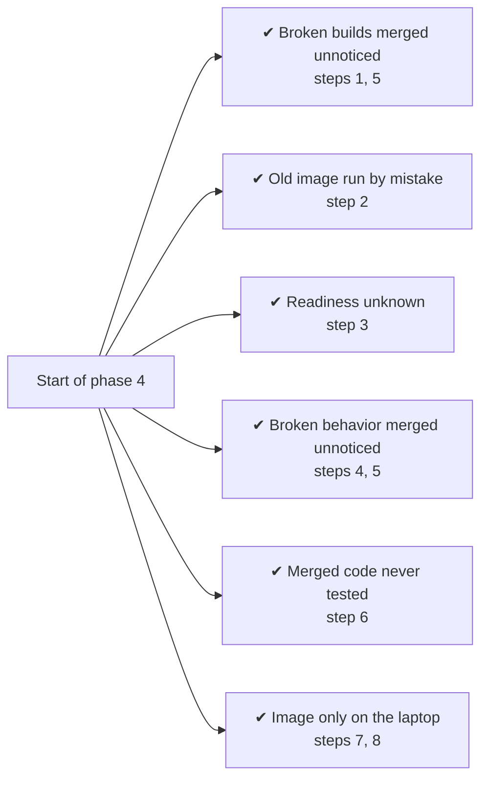
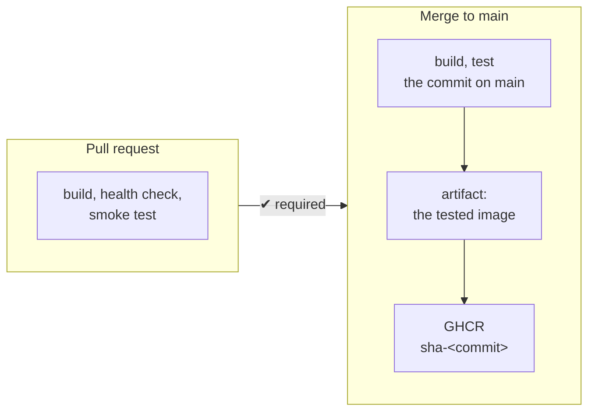

# Phase 4: Result

[← Phase 4](README.md)

## Progress

| Problem | Status | Fixed by |
|---|---|---|
| A broken `Dockerfile` can be merged unnoticed | ✔ Fixed | Step 1: build on every PR |
| Forgetting `--build` runs an old image | ✔ Fixed | Step 2: `pull_policy: build` |
| Nobody knows whether the app is ready | ✔ Fixed | Step 3: health check |
| A building but broken app can be merged | ✔ Fixed | Step 4: smoke test |
| `main` accepts failing or direct changes | ✔ Fixed | Step 5: ruleset |
| The commit on `main` is never tested | ✔ Fixed | Step 6: reusable CI on `main` |
| The tested image dies with its VM | ✔ Fixed | Step 7: artifact |
| The image exists only on the laptop | ✔ Fixed | Step 8: GHCR |

## The pipeline at the end of this phase

## New limitations introduced by this phase

| Limitation | Why it matters |
|---|---|
| Settings live in the GitHub UI, not in Git | No review, no history; recorded only in [repository settings](../../how-to/repository-settings.md) |
| Runner VMs can't be pinned | GitHub updates them; only the OS version is fixed |
| Updates of pinned actions and images are manual | Patches arrive only when someone updates a SHA or digest |
| Values repeat across files | Port `3000`, the app's address, and the Node.js digest appear in several files |
| The required check depends on a job name | Renaming the job blocks every PR until the ruleset is updated |

## Open limitations, ranked

1. **A crashed app stays down:** nothing restarts it, and nobody notices.
2. **Nothing runs the published image:** the app is started from a local build, by hand.
3. **No graceful shutdown:** the app stops correctly only when started with an `init` process.
4. **Offline when the laptop sleeps;** the public URL is random.
5. **Values repeat across files.**
6. **Updates are manual:** base image, actions, cloudflared.
7. **No vulnerability scanning** of the image.
8. **Settings aren't code.**