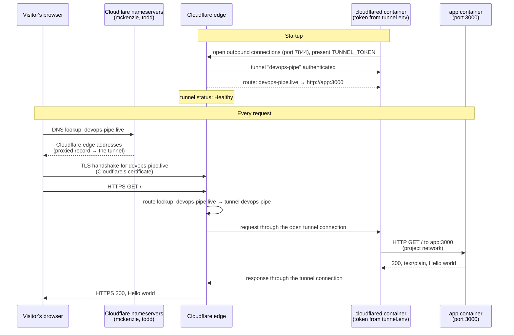

# Step 2: Serve the App on stable Domain

[← Phase 5](README.md)

## Problem

- **The public address is random:** the quick tunnel gets a new `*.trycloudflare.com` name on every start.
- **It can't be shared or relied on:** not on a slide, not in a bookmark, not for monitoring.

## Change

- **A named tunnel, `devops-pipe`,** created in the Cloudflare dashboard (Zero Trust → Networks → Tunnels).
- **A route:** `devops-pipe.live` → `http://app:3000`. Cloudflare created the matching DNS record automatically.
- **`compose.yaml`:** the tunnel service runs the named tunnel; its token comes from `tunnel.env`.
- **`.gitignore`:** `tunnel.env`, added before the file existed.

```yaml
  tunnel:
    image: cloudflare/cloudflared@sha256:a15a3b50...  # 2026.10.1
    command: ["tunnel", "run"]  # named tunnel: routes are set in the Cloudflare dashboard
    env_file:
      - path: tunnel.env    # TUNNEL_TOKEN=...: secret, ignored by Git
        required: false     # CI and fresh clones have no token
    depends_on:
      - app
```

## How it works



- **Outbound only:** `cloudflared` opens the connections; nothing on the laptop accepts connections from the internet.
- **HTTPS ends at Cloudflare's edge:** the visitor sees Cloudflare's certificate for the domain. Inside the tunnel, the traffic is protected by the tunnel connection; the last hop to the app is plain HTTP on the private project network.
- **The DNS record:** a proxied `CNAME` for `devops-pipe.live`, pointing to `<tunnel-id>.cfargotunnel.com`. Visitors only ever see Cloudflare's addresses.

## The token

- **What it is:** the credential that lets a `cloudflared` connect **as this tunnel**.
- **Why it's secret:** anyone holding it can run their own connector and receive traffic for `devops-pipe.live`.
- **Where it lives:** `tunnel.env`, a one-line file (`TUNNEL_TOKEN=...`) on the laptop.
  - Ignored by Git (`.gitignore`), readable only by the user (`chmod 600`).
  - Passed **only to the tunnel container** (`env_file:`); the app never sees it.
  - Written with an editor, not an `echo` command, so it's not in the shell history.
- **If it leaks:** rotate it in the tunnel's settings; the old token stops working.
- **Second line of defense:** GitHub push protection blocks pushes containing recognized secrets.

## Decisions

| Decision | Why |
|---|---|
| Dashboard-managed tunnel (token) | The token works for one tunnel only. The alternative (config file) needs an account-wide certificate on the machine |
| Bare domain `devops-pipe.live` | Shortest address |
| `tunnel.env` via `env_file:`, `required: false` | Only the tunnel gets the secret; CI and fresh clones work without it |
| Replace the quick tunnel | One tunnel, one address |
| `http://app:3000` as the service URL | The app speaks plain HTTP; the address as seen from the tunnel container |

## The analogy

See [analogy](../../explanation/analogy.md), Phase 5: the courier now has a fixed phone number listed in the city's directory, and identifies himself with a badge (the token) when he calls in.

## Before and after

| | Before | After |
|---|---|---|
| Address | Random, new on every start | `https://devops-pipe.live` |
| Finding the address | `docker compose logs tunnel` | Known in advance |
| Credential | None | Token in `tunnel.env`, outside Git |
| Routing | Fixed in the `cloudflared` command | Set in the Cloudflare dashboard |

## Limitations

- **Production runs on the laptop:** the domain serves the app only while the laptop and the containers run.
- **Production still runs a local build:** `docker compose up` builds from the files on disk, not the tested image.
- **Routing lives in the Cloudflare dashboard,** not in Git; recorded in [Cloudflare settings](../../how-to/cloudflare-settings.md).
- **One secret on one laptop:** a lost laptop means rotating the token.

## Verify

```bash
docker compose up -d --wait
docker compose logs tunnel                  # Registered tunnel connection (several)
curl -i https://devops-pipe.live            # HTTP/2 200, Hello world
docker compose run --rm -e BASE_URL=https://devops-pipe.live smoke-test   # ✔
docker compose down
```

- From a phone on mobile data: `https://devops-pipe.live` → `Hello world`.
- After `down` and `up`: the same address works.