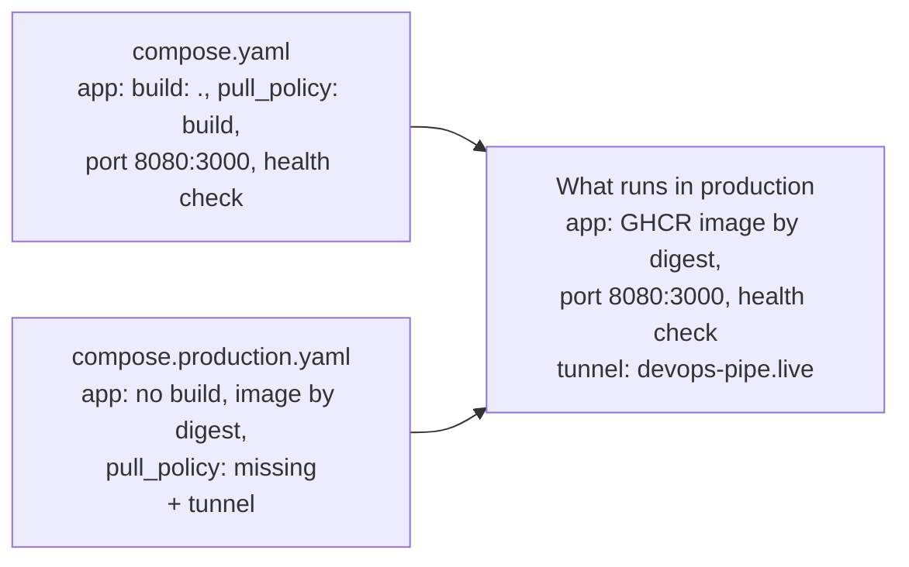
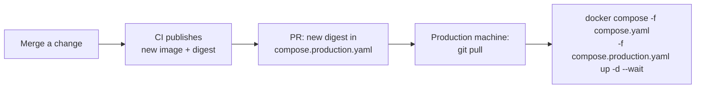

# Step 3: Production Runs the Tested Image

[← Phase 5](README.md)

## Problem

- **Production builds its own image:** `docker compose up` builds from the files on disk, including any uncommitted change.
- **The tested image is unused:** CI publishes exactly what it tested to GHCR, and nothing runs it.
- **The tunnel starts everywhere:** development and CI would expose the app publicly if they started all services.

## Change

`compose.production.yaml` (new): production = `compose.yaml` plus these overrides.

```yaml
services:
  app:
    build: !reset null    # never build in production
    # tag = the commit, for humans; digest = the content, what Docker uses
    image: ghcr.io/bende-kbb/devops-lab:sha-2795306509ee444d6bf3ab7ad98b3f16f30660c5@sha256:d088a22b93eee292885c632381c50c8a678f32fb8c0a54f55c2b91c9a087b45f
    pull_policy: missing  # pull only if not present: a digest's content never changes

  tunnel:
    # moved here from compose.yaml (unchanged)
```

- **Production:** `docker compose -f compose.yaml -f compose.production.yaml up -d --wait`
- **Development and CI:** `docker compose up -d`: app only, built locally, no tunnel.

## How the two files combine



- **Left to right:** later files override the settings they mention; everything else is inherited.
- **Shared settings once:** port and health check live only in `compose.yaml`.
- **`!reset null`:** deletes an inherited setting; production has no build section at all.

## Tag and digest

```
ghcr.io/bende-kbb/devops-lab:sha-2795306...@sha256:d088a22...
                             └ tag: the Git commit ┘└ digest: the image's content ┘
```

| Reference | Points to | Can it change? |
|---|---|---|
| `:sha-<commit>` (tag) | A name, chosen by CI | Yes: a tag can be pushed again with other content |
| `@sha256:<digest>` | The exact bytes | No |

Docker uses the digest and ignores the tag when both are present; the tag shows humans which commit this is.

## `pull_policy`

How Compose gets a service's image when it starts:

| Value | Behavior |
|---|---|
| `missing` | Use the local copy; download only if missing |
| `always` | Download before every start |
| `never` | Never download; fail without a local copy |
| `build` | Build from source on every start |

Production must override `compose.yaml`'s `build`, since it has no build section. `missing` fits a digest: the content can't change, so one download is enough.

## Deploying a new version



- **Git records what runs in production:** every version change is a reviewed commit.
- **The digest comes from the Publish image run's Summary page.**

## Security

- **`config` prints secrets:** `docker compose config` resolves `env_file:`, so the tunnel token appears in plain text. Use `config --images` to check which images will run; never share full `config` output.
- **Production can't build:** the build section is removed, so local files can't reach production.
- **Public exposure only in production:** the tunnel exists only in `compose.production.yaml`.

## Decisions

| Decision | Why |
|---|---|
| Override file instead of a second full file | Shared settings defined once; no drift |
| Tunnel moved to production | Development and CI are never public |
| Tag and digest together | The digest pins the content; the tag documents the commit |
| New versions via PR | Production's state is reviewed and recorded in Git |
| Long command, documented, no script | Deploys are rare and deliberate |

## The analogy

See [analogy](../../explanation/analogy.md), Phase 5: the street truck now comes from the central depot by serial number, already tasted. It's never built in the owner's garage.

## Before and after

| | Before | After |
|---|---|---|
| Production image | Built from the files on disk | The CI-tested image, by digest |
| Uncommitted changes | Reach production | Can't reach production |
| `docker compose up` (development) | App + public tunnel | App only |
| New version | Whatever is on disk | A reviewed digest change |

## Limitations

- **Deploying means typing commands on the production machine:** `git pull` and a long Compose command, by hand.
- **Every deploy causes downtime:** Compose stops the old container before starting the new one.
- **A crashed app stays down:** nothing restarts it.
- **Production runs on the laptop:** online only while it runs.

## Verify

```bash
docker compose -f compose.yaml -f compose.production.yaml config --images
docker compose -f compose.yaml -f compose.production.yaml up -d --wait       # Pulling, no build
docker compose -f compose.yaml -f compose.production.yaml ps --format "table {{.Service}}\t{{.Image}}\t{{.Status}}"
curl -i https://devops-pipe.live                                             # 200 Hello world
docker compose -f compose.yaml -f compose.production.yaml down
```