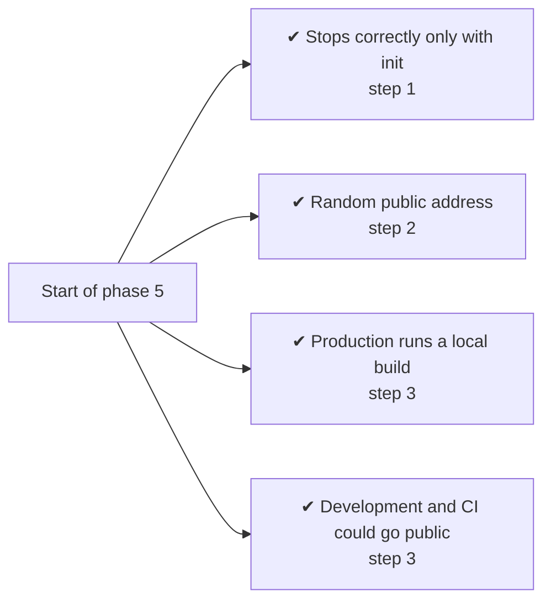
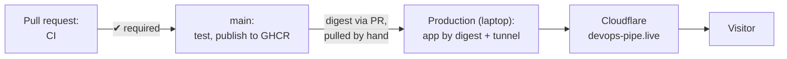

# Phase 5: Result

[← Phase 5](README.md)

## Progress

| Problem | Status | Fixed by |
|---|---|---|
| The app only stops correctly with an `init` process | ✔ Fixed | Step 1: graceful shutdown |
| The public address is random | ✔ Fixed | Step 2: named tunnel → `devops-pipe.live` |
| Production runs a local build | ✔ Fixed | Step 3: GHCR image by digest |
| Development and CI could expose the app | ✔ Fixed | Step 3: tunnel only in `compose.production.yaml` |

## The pipeline at the end of this phase

## New limitations introduced by this phase

| Limitation | Why it matters |
|---|---|
| A secret on the laptop (`tunnel.env`) | Losing the laptop means rotating the token |
| Tunnel routing lives in the Cloudflare dashboard | Not in Git; recorded in [domain and tunnel setup](../../how-to/set-up-the-domain-and-tunnel.md) |
| `docker compose config` prints the token | Full configuration output must never be shared |
| Production commands need both Compose files | Forgetting one leaves orphan containers |

## Open limitations, ranked

1. **Every deploy causes downtime:** Compose stops the old container before starting the new one.
2. **A crashed app stays down:** nothing restarts it.
3. **Deploying means typing commands on the production machine.**
4. **Production runs on the laptop:** online only while it runs.
5. **Values repeat across files:** port, addresses, image digests.
6. **Updates are manual:** base image, actions, cloudflared, the deployed digest.
7. **Settings aren't code:** GitHub and Cloudflare.