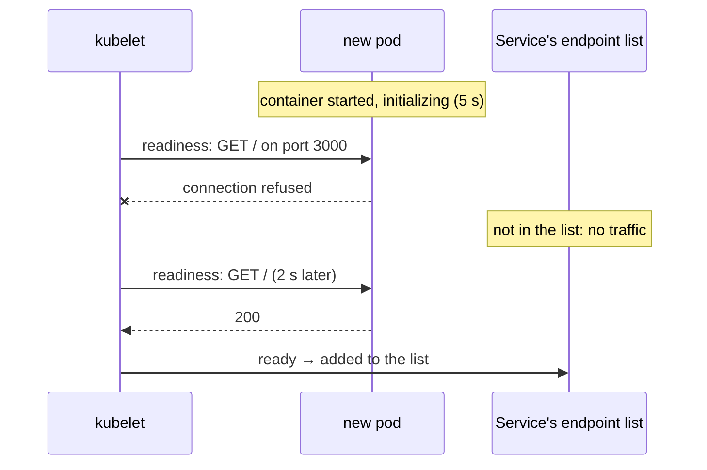
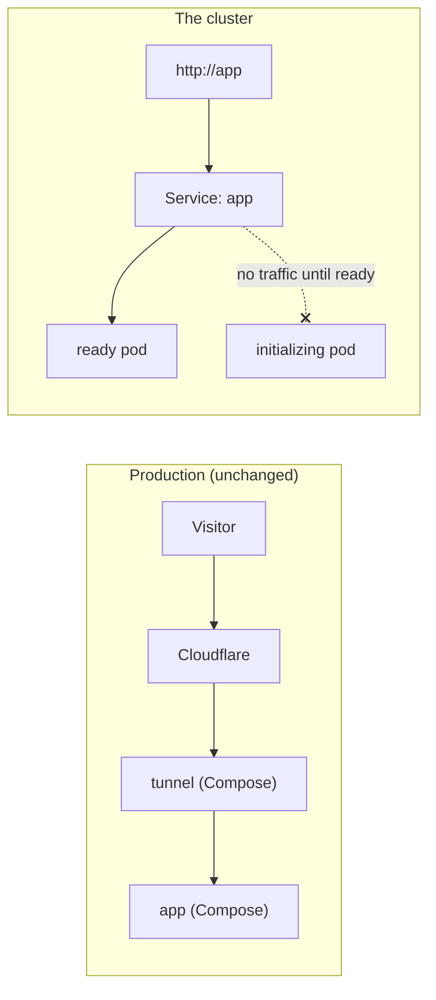

# Step 10: Send Traffic Only to Ready Pods

[← Phase 6](README.md)

## Problem

- **A pod counts as ready when its container starts:** the app needs 5 seconds before it listens.
- **The Service sends traffic to it anyway:** requests to an initializing pod fail.
- **A hanging app would keep receiving traffic:** nothing checks whether it still answers.

## Change

`kubernetes/app-deployment.yaml`, in the container:

```yaml
readinessProbe:
  httpGet:
    path: /
    port: 3000
  periodSeconds: 2
livenessProbe:
  httpGet:
    path: /
    port: 3000
  periodSeconds: 10
  failureThreshold: 3
```

| Probe | Question | When it fails |
|---|---|---|
| **Readiness** | Can this pod take requests right now? | Removed from the Service's endpoint list; keeps running |
| **Liveness** | Is the container still alive? | After 3 failures in a row (~30 s): the container is restarted |

## How it works



- **The kubelet** on the pod's node runs the probes.
- **`0/1 Running`** in `kubectl get pods`: started, not ready yet.

## How users are served

**Unchanged:** visitors still reach the Compose app. In the cluster, only ready pods receive requests.



## Measurement

A loop inside one pod requested `http://app` about three times per second, opening a new connection each time; meanwhile, the other pod was deleted and replaced.

| | Failed requests | Duration |
|---|---|---|
| Without probes | 7 (`ECONNREFUSED`) | ~4 s |
| With probes | 0 | — |

Applying the probes also replaced both pods **one at a time**: each new pod became ready before an old one was terminated.

## Decisions

| Decision | Why |
|---|---|
| Readiness and liveness | Readiness fixes the problem; liveness restarts a hanging app |
| `GET /` on port 3000 | The same check as Compose's health check; no app change |
| Readiness every 2 s | A ready pod receives traffic within ~2 s |
| Liveness every 10 s, 3 failures | Never restarts a pod during its 5-second startup |

## The analogy

See [analogy](../../explanation/analogy.md), Phase 6: the switchboard rings a truck only once its "open" sign is up.

## Before and after

| | Before | After |
|---|---|---|
| Traffic to an initializing pod | Yes: requests fail | No |
| A hanging container | Keeps receiving traffic | Restarted after ~30 s |
| Replacing a pod | 7 failed requests | 0 |

## Limitations

- **The probes check `/`:** the same response users get; a dedicated health endpoint could check more.
- **Users are still served by Compose.**

## Verify

```bash
k3d cluster start devops-lab
kubectl apply -f kubernetes/app-deployment.yaml
kubectl get pods --watch            # new pods: 0/1 for ~5 s, then 1/1
kubectl describe pod <new pod>      # Events: Readiness probe failed ... (first seconds only)
k3d cluster stop devops-lab
```