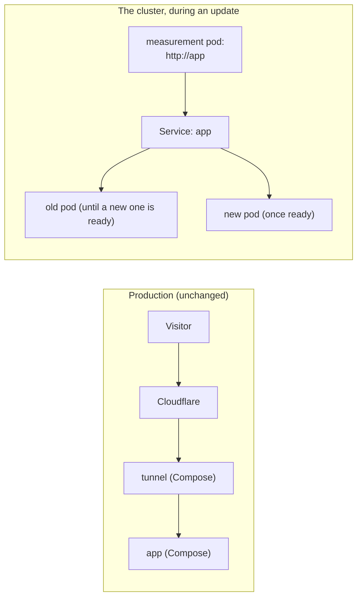

# Step 11: Deploy a New Version Without Downtime

[← Phase 6](README.md)

## Problem

- **Every Compose deploy causes downtime:** the old container stops before the new one starts; measured in step 2: 11 failed requests over ~6 s.

## Change

- **`kubernetes/app-deployment.yaml`:** the `image:` line updated to the latest published image, then `kubectl apply`.

## How it works

```mermaid
sequenceDiagram
    participant D as Deployment
    participant N as new pods
    participant O as old pods (2)
    participant S as Service

    D->>N: start new pod 1
    Note over N: initializing; readiness fails → no traffic
    N-->>S: ready → added to endpoints
    D->>O: terminate old pod 1
    O-->>S: removed from endpoints, finishes open requests, exits
    D->>N: start new pod 2
    N-->>S: ready → added
    D->>O: terminate old pod 2
```

- **A rolling update:** a new pod template makes the Deployment create a new ReplicaSet, and shift pods from the old one to the new one, one at a time.
- **Defaults:** at most one extra pod during the update, and no ready pod missing.
- **Readiness gates every step;** graceful shutdown finishes open requests.

## How users are served

**Unchanged:** visitors still reach the Compose app. In the cluster, `http://app` stayed served throughout the update.



## Measurement

A separate pod (`kubectl run measure`, no app label, so never a Service target) requested `http://app` about three times per second, a new connection each time, during the update.

| Deploy | Failed requests |
|---|---|
| Compose (step 2) | 11, over ~6 s |
| Kubernetes rolling update | 0 |

```
$ kubectl get replicasets
NAME             DESIRED   CURRENT   READY
app-6468b97d5c   2         2         2      # new image
app-675d95464d   0         0         0      # step 8: no probes
app-d587cdc9     0         0         0      # step 10: probes
```

- **One ReplicaSet per pod template;** old ones are kept at 0 as rollback points.

## Decisions

| Decision | Why |
|---|---|
| The latest published image, by digest, in the manifest | A real version change, reviewed like everything else |
| Default update strategy | Already one-at-a-time with readiness gating; no data showing a need to tune |
| Measured from a separate pod | The app's pods are replaced during the update |

## The analogy

See [analogy](../../explanation/analogy.md), Phase 6: shift change, one truck at a time.

## Before and after

| | Compose | Kubernetes |
|---|---|---|
| Failed requests during a deploy | 11 | 0 |
| Order | Stop old, then start new | Start new, wait until ready, then stop old |

## Limitations

- **Deploying means typing commands:** editing the image line and running `kubectl apply` by hand.
- **Users are still served by Compose.**
- **The image digest appears in two files:** `compose.production.yaml` and `kubernetes/app-deployment.yaml`.

## Verify

```bash
k3d cluster start devops-lab
kubectl run measure --image=<image> --restart=Never --command -- node -e "<loop>"
kubectl logs -f measure                       # second terminal: 200s throughout
kubectl apply -f kubernetes/app-deployment.yaml
kubectl rollout status deployment/app         # successfully rolled out
kubectl get replicasets
kubectl delete pod measure
k3d cluster stop devops-lab
```