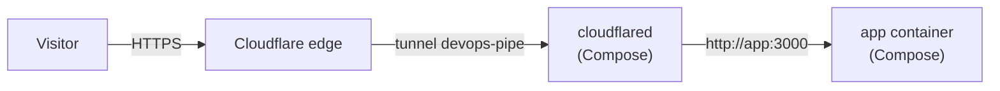
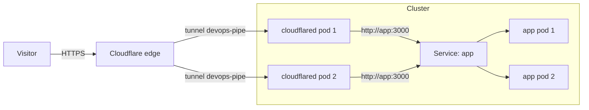
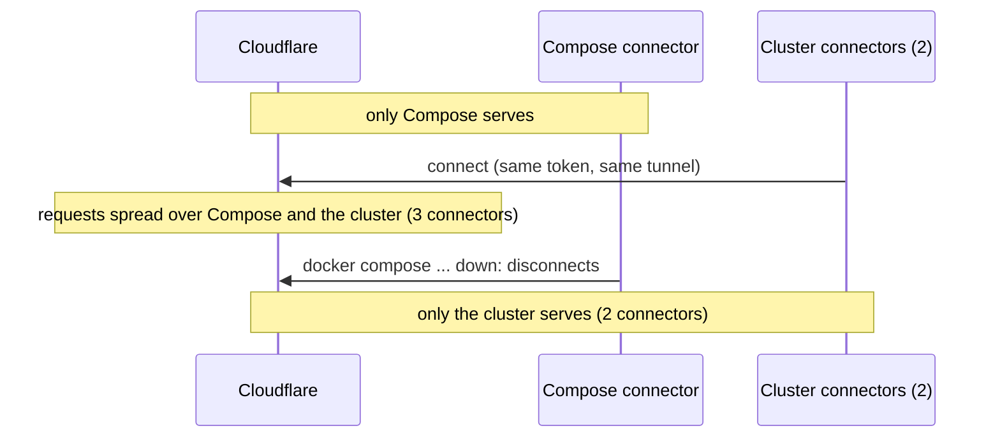

# Step 12: Serve Production Traffic from the Cluster

[← Phase 6](README.md)

## Problem

- **Users are still served by Compose:** rolling updates and self-healing only benefit the cluster's test traffic.

## Change

- **`kubernetes/tunnel-deployment.yaml`:** 2 `cloudflared` connectors in the cluster, image pinned by digest, label `app.kubernetes.io/name: tunnel`.
- **A Kubernetes Secret `tunnel-token`,** created from `tunnel.env`, never written to Git:

```bash
kubectl create secret generic tunnel-token --from-env-file=tunnel.env
```

- **`kubernetes/app-service.yaml`:** port 80 → **3000**, so the tunnel's route `http://app:3000` is valid in Compose and in the cluster.

```yaml
          args: ["tunnel", "run"]
          envFrom:
            - secretRef:
                name: tunnel-token  # provides TUNNEL_TOKEN
```

## How users are served

**Before:**



**After:**



- **Several connectors per tunnel:** Cloudflare spreads requests across all connected ones.
- **The Service** is reached by name from the connector pods, exactly as Compose's tunnel reached the app container.

## The switch



- **An overlap instead of a gap:** both environments served the same route for ~30 s.
- **No dashboard change:** the route `http://app:3000` resolves in both places.

## Measurement

The loop from step 1, against `https://devops-pipe.live`:

| Event | Failed requests |
|---|---|
| The switch (`docker compose ... down`) | 0 |
| An app pod and a connector pod deleted | 2 (`000`: no answer within 2 s), in ~60 requests; site stayed up, nobody acted |
| Compose crash, for comparison (step 1) | ~16 s down, until a person acted |

- **The 2 failures:** removing a pod from traffic and stopping it happen at the same time; a request can land on a pod that's shutting down.

## The Secret

- **What it is:** a Kubernetes object for sensitive values; `envFrom` turns its entries into environment variables.
- **Where it lives:** the cluster's datastore, **encoded, not encrypted**. Anyone with the kubeconfig can read it.
- **Never print it:** `kubectl get secret tunnel-token -o yaml` shows the token, base64-encoded (trivially reversible). `kubectl get secret tunnel-token` shows only its size.

## Decisions

| Decision | Why |
|---|---|
| Secret created from `tunnel.env` by command | The token never enters a file in Git |
| 2 connectors | One can fail while the other serves |
| Service port 3000 | The route works in both places: switch without downtime, no dashboard change |
| Overlap, then stop Compose | No gap during the switch |
| A separate label for the connectors | The app's Service must never select them |
| `compose.production.yaml` kept, unused | A tested way back |

## The analogy

See [analogy](../../explanation/analogy.md), Phase 6: the courier's lines now lead into the lot.

## Before and after

| | Before | After |
|---|---|---|
| Production runs on | Compose | The cluster |
| Deploy | Downtime | Rolling update |
| A crashed or deleted pod | Down until someone acts | Replaced automatically |
| Tunnel connectors | 1 | 2 |

## Limitations

- **Production runs only while the cluster runs:** `k3d cluster stop` takes the site offline.
- **Deleting a pod can fail single requests:** the shutdown race. A short pause before shutdown (`preStop` hook) is the usual fix.
- **The Secret is readable by anyone with the kubeconfig;** it's created by hand, outside Git.
- **Deploying means typing commands:** editing manifests and `kubectl apply`.
- **Values repeat across files:** the image digest, ports, and labels appear in several manifests and in `compose.production.yaml`.

## Verify

```bash
kubectl get pods                                             # 2 app pods, 2 tunnel pods
kubectl logs deployment/tunnel | grep "Registered tunnel connection"
curl -i https://devops-pipe.live                             # 200 Hello world
```