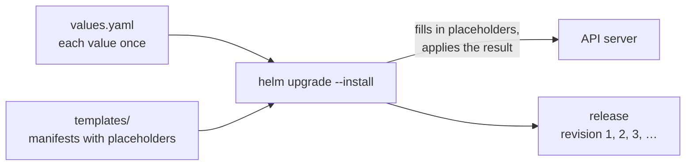

# Step 13: Install Helm

[← Phase 6](README.md)

## Problem

- **Values repeat across manifests:** the app's label appears four times, port 3000 four times; a mismatch silently breaks the Service.
- **No single unit:** the app is several files, applied one by one, with no version and no undo for the whole set.
- **No tool to package them.**

## Change

- **Helm v4.3.1** installed to `/usr/local/bin/helm`, from Helm's official download site, checksum verified.

## What Helm is



- **The package manager for Kubernetes:** an app's manifests packaged as a **chart**.
- **Templates and values:** manifests with placeholders, and one file of values.
- **A release:** an installed copy of a chart, with a revision history and one-command rollback.
- **Same credentials as `kubectl`:** it uses `~/.kube/config` and its current context.

## Decisions

| Decision | Why |
|---|---|
| Newest release at least 14 days old | The cooldown rule |
| Official archive, checksum verified | Nothing runs before it's verified; not the install script |
| `/usr/local/bin` | Like k3d and kubectl |

## Before and after

| | Before | After |
|---|---|---|
| Package and install the app as one unit | Not possible | `helm` |

## Limitations

- **Updates are manual:** a new version means repeating the download and verification.
- **The app isn't a chart yet.**

## Verify

```bash
helm version   # Version:"v4.3.1"
```