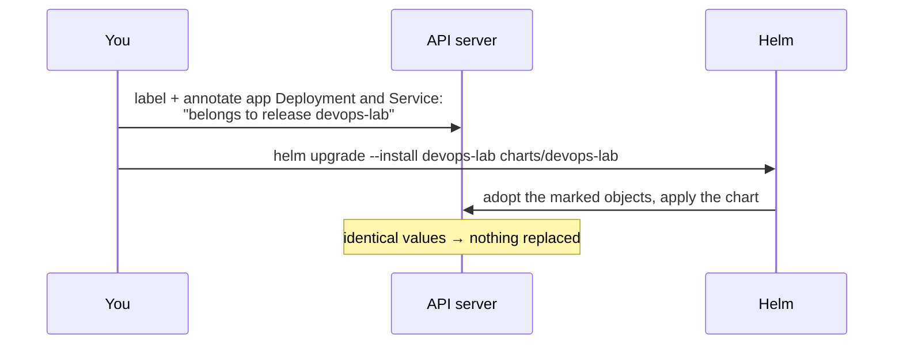
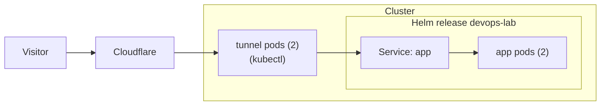

# Step 14: Package the App as a Chart

[← Phase 6](README.md)

## Problem

- **Values repeat across manifests:** port 3000 appeared four times; a mismatch silently breaks the Service.
- **No single unit:** the app was two files, applied one by one.
- **No undo for the whole set:** rolling back meant reverting files and re-applying them by hand.

## Change

`charts/devops-lab/`:

```
Chart.yaml                    # name: devops-lab, version: 0.1.0
values.yaml                   # image, replicas, port: each once
templates/app-deployment.yaml # moved from kubernetes/, values replaced by placeholders
templates/app-service.yaml    # moved from kubernetes/, values replaced by placeholders
```

```yaml
# values.yaml
image: ghcr.io/bende-kbb/devops-lab:sha-…@sha256:…
replicas: 2
port: 3000
```

```yaml
# templates (excerpt)
replicas: {{ .Values.replicas }}
image: {{ .Values.image }}
containerPort: {{ .Values.port }}
```

- **`{{ .Values.port }}`:** "insert `port` from `values.yaml` here." Helm fills in every placeholder, then applies the result.
- **`helm template`** shows the result without applying anything.

## How the running app was handed over



- **Adoption:** Helm only manages objects it created, or objects marked as belonging to a release.
- **Field ownership:** Kubernetes records which tool owns each field. The first change to a field `kubectl` had written was refused, until `--force-conflicts` let Helm take it over.

## How users are served

**Unchanged and uninterrupted:** the same objects keep running; only who manages the app changed.



## Results

| Test | Result |
|---|---|
| Handover, loop on `devops-pipe.live` | 0 failed requests |
| `--set replicas=3` | A third pod; revision 4 |
| `helm rollback devops-lab 1` | Back to 2 pods; revision 5 |

```
REVISION  STATUS      DESCRIPTION
1         superseded  Install complete
2         failed      Upgrade failed: conflict ... .spec.replicas
3         superseded  Rollback to 1
4         superseded  Upgrade complete
5         deployed    Rollback to 1
```

- **A rollback adds a revision;** history is never erased, failures included.

## Decisions

| Decision | Why |
|---|---|
| Adoption instead of reinstalling | No downtime |
| The Secret stays outside the chart | Helm stores what it installs in its release history |
| The tunnel stays outside the chart, for now | Enough to show Helm's value; recorded as later work |

## The analogy

See [analogy](../../explanation/analogy.md), Phase 6: the fill-in-the-blanks event plan and its logbook.

## Before and after

| | Before | After |
|---|---|---|
| Port 3000 written | 4 times | Once |
| Install the app | `kubectl apply`, per file | `helm upgrade --install` |
| Undo | Revert files, re-apply | `helm rollback` |

## Limitations

- **The tunnel is still a separate manifest,** applied with `kubectl`.
- **Deploying means typing commands:** `helm upgrade` by hand.
- **The image digest appears in two files:** `values.yaml` and `compose.production.yaml`.

## Later work

- The tunnel inside the chart; shared label helpers; chart checks in CI (`helm lint`); publishing the chart to a registry; per-environment values files; Secret tooling (Sealed Secrets, External Secrets).

## Verify

```bash
helm template devops-lab charts/devops-lab   # rendered manifests
helm list                                    # devops-lab, deployed
helm history devops-lab                      # revisions
```