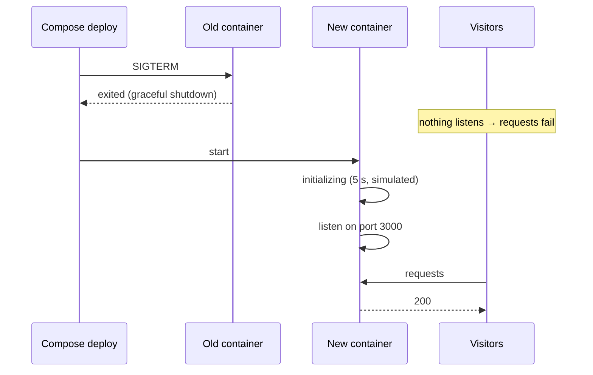

# Step 2: Model a Realistic Startup Time

[← Phase 6](README.md)

## Problem

- **The app starts in milliseconds:** real services take seconds before they can answer (loading configuration, connecting to databases, warming caches).
- **So the deploy gap was invisible:** step 1 measured no failed requests, although Compose always stops the old container before the new one starts.

## Change

`server.js`, a declared simulation:

```js
// Simulated initialization: real services take seconds to start
// (loading configuration, connecting to databases, warming caches).
// This app models one; the delay is deliberate, not real work.
const STARTUP_DELAY_MS = 5000;

console.log(`Initializing (simulated, ${STARTUP_DELAY_MS / 1000} s)...`);
setTimeout(() => {
  server.listen(3000);
  console.log("Listening on port 3000");
}, STARTUP_DELAY_MS);
```

- **For 5 seconds after starting,** nothing listens: connections are refused, as with a real service still initializing.
- **The health check** turns healthy later; `--wait`, the smoke test, and CI wait for it.

## How a deploy looks now



## Decisions

| Decision | Why |
|---|---|
| Simulate startup time, not work per request | Startup time is what creates the deploy gap. Work per request is a capacity problem, and in Node.js it would block the whole process, health checks included |
| 5 seconds | A typical order of magnitude for a service that connects to dependencies |
| Declared in code and docs | A model, not a hidden trick |

## Results

Same loop as step 1, against `http://localhost:8080`, during `docker compose up -d --wait --force-recreate app`:

| | Step 1 | Step 2 |
|---|---|---|
| Failed requests during a deploy | 0 | 11 (`000`: connection refused) |
| Duration | Shorter than the loop's interval | ~6 s |

## Limitations

- **Every deploy causes ~6 s of downtime.**
- **A crashed app stays down** until someone restarts it.
- **The startup delay is fixed in the code.**

## Verify

```bash
docker compose up -d --wait
docker compose logs app        # Initializing (simulated, 5 s)... / Listening on port 3000
# second terminal: the loop from step 1, against http://localhost:8080
docker compose up -d --wait --force-recreate app   # ~6 s of 000
docker compose down
```