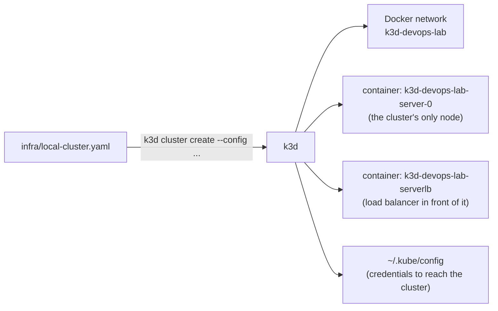

# Step 4: Create a Minimal Cluster

[← Phase 6](README.md)

## Problem

- **No cluster:** Kubernetes runs workloads in a cluster, and none exists.

## Change

`infra/local-cluster.yaml`, the cluster's blueprint:

```yaml
apiVersion: k3d.io/v1alpha5
kind: Simple
metadata:
  name: devops-lab
servers: 1
agents: 0
image: rancher/k3s:v1.35.5-k3s1@sha256:2074403a...
options:
  k3s:
    extraArgs:
      - arg: --disable=traefik
        nodeFilters:
          - server:*
```

- **One server node, no agents:** the smallest working cluster.
- **Kubernetes 1.35.5 (k3s),** pinned by digest; release checked against the 14-day cooldown.
- **Traefik disabled:** the bundled ingress controller isn't used.

## How it was created



- **The node is a Docker container,** running k3s.
- **The cluster gets its own Docker network,** like a Compose project.
- **`~/.kube/config`** is written by k3d, outside the repo; it's what tools will use to reach the cluster.
- **The blueprint stays in the repo:** deleting the cluster and creating it again gives the same cluster.

## Using it

```bash
k3d cluster create --config infra/local-cluster.yaml   # build it
k3d cluster stop devops-lab                            # stop: keeps everything inside
k3d cluster start devops-lab                           # start again
k3d cluster delete devops-lab                          # delete: everything inside is gone
```

## Decisions

| Decision | Why |
|---|---|
| One server, no agents | The smallest cluster; more nodes come in a later step |
| k3s version pinned by digest | The same Kubernetes every time it's created |
| Traefik disabled | Unused software is unused attack surface |
| Blueprint in `infra/` | Cluster setup separate from the app's Kubernetes files |

## The analogy

See [analogy](../../explanation/analogy.md), Phase 6: the lot's plan, and the lot built from it, open, no trucks yet.

## Before and after

| | Before | After |
|---|---|---|
| Kubernetes cluster | None | `devops-lab`, one node |
| How it's defined | — | A file in the repo |

## Limitations

- **Nothing runs in it yet.**
- **One node:** if it stops, the whole cluster stops.
- **k3d's helper images** (`k3d-tools`, `k3d-proxy`) are chosen by k3d's version, not pinned in the blueprint.
- **A running cluster uses memory,** even when empty.

## Verify

```bash
k3d cluster create --config infra/local-cluster.yaml
k3d cluster list     # devops-lab   1/1   0/0
docker ps --format "table {{.Names}}\t{{.Image}}\t{{.Status}}"
```