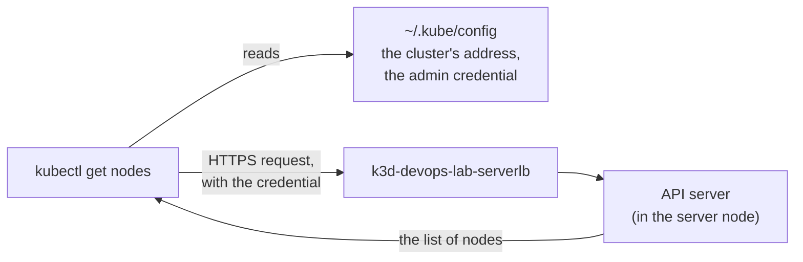

# Step 5: Look into the Cluster

[← Phase 6](README.md)

## Problem

- **The cluster is a black box:** it runs, but there's no way to see what's inside, give it instructions, or investigate problems.
- **k3d can't help:** it builds, stops, and deletes the cluster's containers; it doesn't talk to the Kubernetes inside them.

## Change

- **`kubectl` v1.35.5** installed to `/usr/local/bin/kubectl`, from Kubernetes' official download site, checksum verified.

## How it works



- **The API server is the only way into a cluster:** every action is an HTTPS request to it. `kubectl` turns commands into those requests, and the answers into readable tables.
- **The API server only answers clients that prove who they are:** `kubectl` presents the admin certificate that the cluster issued at creation, stored by k3d in `~/.kube/config`.
- **The current context** in that file selects which cluster `kubectl` talks to: `k3d-devops-lab`.

## The first look

```
$ kubectl get nodes
NAME                      STATUS   ROLES           AGE   VERSION
k3d-devops-lab-server-0   Ready    control-plane   ...   v1.35.5+k3s1
```

- **`Ready`:** the node can run workloads.
- **`control-plane`:** this node runs the control plane.
- **`v1.35.5+k3s1`:** the version pinned in the blueprint.

## Security

- **`~/.kube/config` is the cluster's admin credential:** full control of this local cluster, nothing else.
- **Readable only by the user** (`-rw-------`), outside the repo, never committed.

## Decisions

| Decision | Why |
|---|---|
| `kubectl` v1.35.5, the cluster's exact version | `kubectl` supports clusters one minor version older or newer; the same version avoids any mismatch |
| Official download, checksum verified | The official binary, verified before running |
| `/usr/local/bin` | Installed by hand, outside `apt` |

## The analogy

See [analogy](../../explanation/analogy.md), Phase 6: the phone to the lot's office, and the owner's ID card.

## Before and after

| | Before | After |
|---|---|---|
| See inside the cluster | Not possible | `kubectl get nodes` |
| Give the cluster instructions | Not possible | `kubectl` |

## Limitations

- **Updates are manual:** a new `kubectl` means repeating the download and verification, matching the cluster's version.
- **Nothing of ours runs in the cluster yet.**

## Verify

```bash
k3d cluster start devops-lab
kubectl config current-context   # k3d-devops-lab
kubectl get nodes                # k3d-devops-lab-server-0   Ready
kubectl version                  # Client v1.35.5, Server v1.35.5+k3s1
k3d cluster stop devops-lab
```