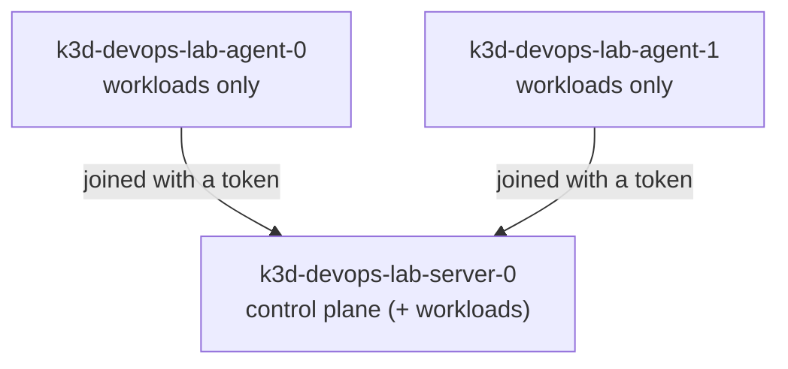

# Step 6: Add Agent Nodes

[← Phase 6](README.md)

## Problem

- **One node does everything:** the control plane, and every workload.
- **Nothing to spread across:** if that node stops, everything stops, and Kubernetes has nowhere to move work.

## Change

`infra/local-cluster.yaml`:

```yaml
agents: 2   # nodes running workloads only
```

The cluster was deleted (it was empty) and recreated from the blueprint.

## How it works



- **An agent** is a node without a control plane. Its kubelet registers with the server's API server and runs whatever the scheduler places on it.
- **Joining:** each agent starts k3s's node software with the API server's address and a join token (a secret proving it belongs to this cluster); k3d handles both.
- **The scheduler** can now place work on any of the three nodes.

## Three real nodes, one machine

- **Real nodes:** each agent joins and behaves exactly like a node on a separate machine; Kubernetes spreads work across them and moves work away from a stopped node.
- **One machine:** all three are containers on the same laptop; a hardware failure would stop them all.
- **In production:** each node runs on its own machine (own servers, rented virtual machines, or a cloud provider's managed cluster), joined the same way.

## Results

```
$ kubectl get nodes
NAME                      STATUS   ROLES           AGE   VERSION
k3d-devops-lab-agent-0    Ready    <none>          ...   v1.35.5+k3s1
k3d-devops-lab-agent-1    Ready    <none>          ...   v1.35.5+k3s1
k3d-devops-lab-server-0   Ready    control-plane   ...   v1.35.5+k3s1
```

| Container | Memory (empty cluster) |
|---|---|
| `server-0` | ~570 MB |
| `agent-0`, `agent-1` | ~120 MB each |
| `serverlb` | ~25 MB |

Agents are light: they run no control plane.

## Decisions

| Decision | Why |
|---|---|
| 2 agents | Enough to spread work and lose one node |
| Changed in the blueprint, cluster recreated | The blueprint stays the single source of truth; adding nodes by command would make file and cluster disagree |
| Workloads allowed on the server | k3s's default; keeping them off needs another concept, not needed here |

## The analogy

See [analogy](../../explanation/analogy.md), Phase 6: more parking spaces, one office.

## Before and after

| | Before | After |
|---|---|---|
| Nodes | 1 (server) | 3 (1 server, 2 agents) |
| Memory, empty | ~600 MB | ~840 MB |
| Places to run work | 1 | 3 |

## Limitations

- **All nodes share one machine:** a hardware failure stops the whole cluster.
- **Nothing of ours runs in the cluster yet.**

## Verify

```bash
k3d cluster create --config infra/local-cluster.yaml
kubectl get nodes          # 3 nodes, all Ready
docker stats --no-stream   # memory per node container
k3d cluster stop devops-lab
```