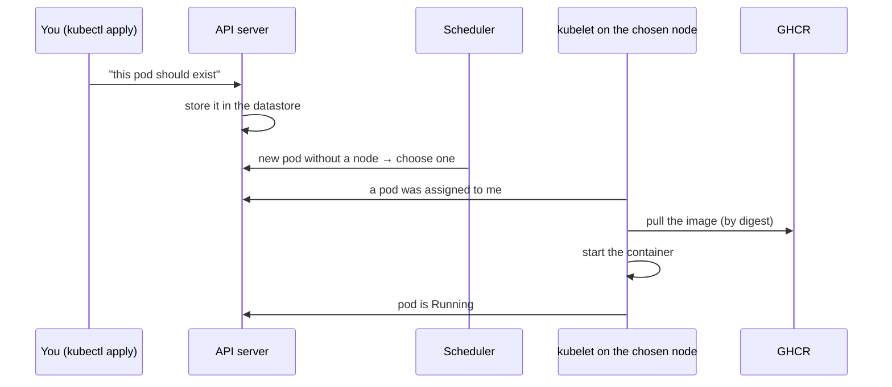
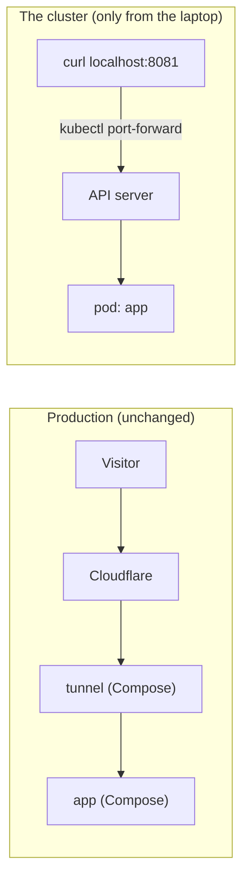

# Step 7: Run the App as a Pod

[← Phase 6](README.md)

## Problem

- **Nothing of ours runs in the cluster:** three nodes are ready, and the app still runs only in Compose.

## Change

`kubernetes/app-pod.yaml`, the first manifest:

```yaml
apiVersion: v1
kind: Pod
metadata:
  name: app
spec:
  containers:
    - name: app
      image: ghcr.io/bende-kbb/devops-lab:sha-<commit>@sha256:<digest>
      ports:
        - containerPort: 3000
```

- **A pod:** the smallest thing Kubernetes runs; a wrapper around one container, with its own IP address inside the cluster.
- **A manifest:** a file describing an object's desired state. `kind` says what it is; `spec` says what it should be like.
- **The image:** the CI-tested image, by digest, pulled from GHCR by the node itself.

## How it works



- **Declarative:** `kubectl apply` hands over the desired state; the cluster does the rest.
- **The scheduler** chose one of the three nodes; `kubectl get pods -o wide` shows which, and the pod's IP (`10.42.x.x`: the cluster's internal pod network).
- **If the pull fails,** the kubelet keeps retrying, with growing pauses (`ImagePullBackOff`), until it works.

## How users are served

**Unchanged:** visitors still reach the Compose app. The pod is reachable only from the laptop, through `kubectl port-forward`.



- **`kubectl port-forward pod/app 8081:3000`** connects a local port to the pod, through the API server, while the command runs. A testing tool, not a way to serve users.

## Decisions

| Decision | Why |
|---|---|
| Manifest file + `kubectl apply` (not `kubectl run`) | Declarative, and recorded in Git |
| The published image, by digest | The cluster runs exactly what CI tested |
| `kubernetes/` folder | The app's Kubernetes files, separate from the cluster's blueprint in `infra/` |
| `kubectl port-forward` for testing | No stable address exists yet |

## The analogy

See [analogy](../../explanation/analogy.md), Phase 6: an order form handed to the office, and one truck parked in a space.

## Before and after

| | Before | After |
|---|---|---|
| The app in the cluster | No | One pod, on one node |
| How it got there | — | A manifest, applied |
| Who can reach it | — | The laptop, via `port-forward` |

## Limitations

- **A deleted pod stays deleted:** after `kubectl delete pod app`, nothing recreates it. The same happens if its node stops.
- **No stable address:** the pod's IP belongs to this pod only; reaching it needs `port-forward`.
- **Users are still served by Compose.**

## Verify

```bash
k3d cluster start devops-lab
kubectl apply -f kubernetes/app-pod.yaml      # pod/app created
kubectl get pods -o wide                      # Running, on one node
kubectl logs app                              # Initializing... / Listening on port 3000
kubectl port-forward pod/app 8081:3000        # second terminal
curl -i http://localhost:8081                 # 200 Hello world
kubectl delete pod app                        # gone, not recreated
k3d cluster stop devops-lab
```